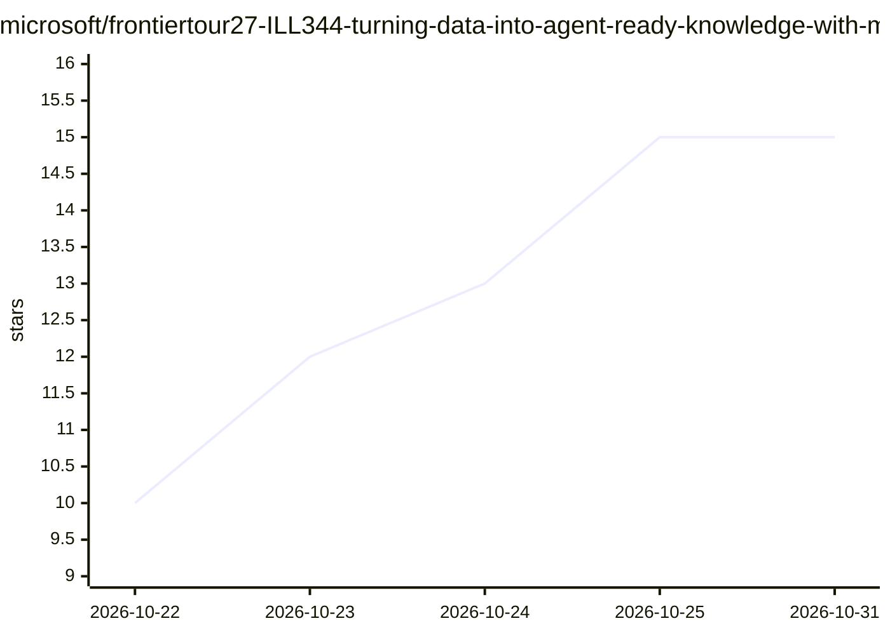

# microsoft/frontiertour27-ILL344-turning-data-into-agent-ready-knowledge-with-microsoft-iq

⭐ 15 · Python · MIT · 推送 2026-10-30 · [GitHub](https://github.com/microsoft/frontiertour27-ILL344-turning-data-into-agent-ready-knowledge-with-microsoft-iq) · 组织维护

**微软 Frontier Tour 实验：用 IQ 服务构建 agent 就绪知识库**

微软 Frontier Tour 2027 课程 ILL344 的动手实验仓库：引导学习者用 Foundry IQ（Azure AI Search）agentic 检索构建多源企业知识库，用 Fabric IQ 从 OneLake 获取结构化数据，用 Work IQ 引入组织上下文，并用 Microsoft Agent Framework 编写以该知识库为答案依据的 Python agent。提供 5 个按序完成的 Jupyter notebook，支持现场引导或自学两种模式（自学需克隆仓库并自行部署资源）。

## 筛选速览

| 维度 | 判定 | 备注 |
|---|---|---|
| AI 角色 | `ai-knowledge` | 知识聚合/清单类 |
| 许可风险 | `permissive` | MIT |
| 部署形态 | `None` |  |
| 模型依赖 | — | README 未给出锁定关系 |
| 硬件要求 | — | 无带数字的原话,不猜 |
| 安装摩擦 | `low` | 无编译、无系统依赖或容器化 |
| 成熟度 | — | 结构信号不足 |

## 能力要点

- 五个按序完成的 Jupyter notebook 实验流程
- 覆盖 Foundry IQ / Fabric IQ / Work IQ 三类知识源
- 用 Microsoft Agent Framework 构建答案有据可依的 agent
- 附讲师交付材料（讲义、录制、演示指引）

## 适用场景

- 跟着实验学习搭建多源 agent 知识库
- 了解 agentic retrieval 索引设计方法
- 讲师或合作方复用材料再交付该课程

## 场景标签

`教程课程` `RAG` · 领域:知识与检索

## 证据(README 行号)

> L9: Use Foundry IQ to build a multi-source knowledge base with agentic retrieval, Fabric IQ to retrieve structured data 
> L33: - Build a multi-source knowledge base over indexed enterprise content using Foundry IQ (Azure AI Search) agentic re

## 星数曲线

2026-10-22 10 → 2026-10-31 15（+5）

---
*卡片 v1 · prompt 1.4 · 生成 2026-10-30 · 置信度 high · 依据 README sha `44e8cb197672` · [字段定义](../../DATASET.md)*
