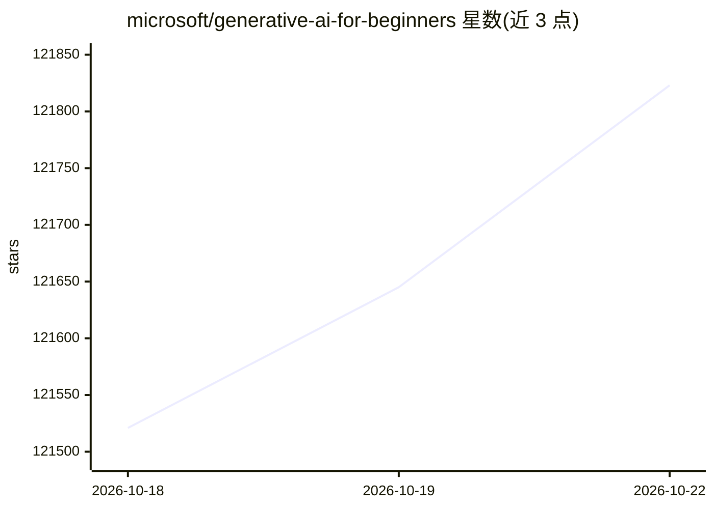

# microsoft/generative-ai-for-beginners

⭐ 121,929 · Jupyter Notebook · MIT · 推送 2026-10-22 · [GitHub](https://github.com/microsoft/generative-ai-for-beginners) · 组织维护

**面向初学者的生成式 AI 应用开发入门课程（21 课）**

微软云推广团队制作的 21 课生成式 AI 应用开发课程，第 3 版。课程分 "Learn"（讲解概念：LLM 原理、模型选择、负责任 AI、提示工程、微调等）与 "Build"（配套 Python 与 TypeScript 代码示例：文本生成、聊天、向量检索、图像生成、RAG、AI Agent 等）两类，每课含视频介绍、README 讲义与延伸资源。代码可接入 Azure OpenAI、Microsoft Foundry Models、OpenAI API 或本地运行的 Foundry Local；仓库提供 50+ 语言翻译，并给出排除翻译目录的 sparse checkout 克隆方式。

## 筛选速览

| 维度 | 判定 | 备注 |
|---|---|---|
| AI 角色 | `ai-knowledge` | 知识聚合/清单类 |
| 许可风险 | `permissive` | MIT |
| 部署形态 | `None` |  |
| 模型依赖 | locked-api |  |
| 硬件要求 | — | 无带数字的原话,不猜 |
| 安装摩擦 | `low` | 无编译、无系统依赖或容器化 |
| 成熟度 | — | 结构信号不足 |

## 动量与使用信号

- 维护:`active` — 距上次 push 0.7 天,年发版 0,153 位贡献者
- 涨星:近 1 天 **+73**(自 20261016 起算)
- 平台:WINDOWS / MACOS / LINUX · 协议:OPENAI-API / MCP

## 能力要点

- 21 课覆盖概念讲解与代码实践，代码示例提供 Python 与 TypeScript 两种语言
- 支持 Azure OpenAI、Microsoft Foundry Models、OpenAI API 及本地离线运行的 Foundry Local 四种模型接入途径
- 提供 50+ 语言翻译版本，可用 sparse checkout 排除翻译目录以减小克隆体积
- 课程主题包含提示工程、RAG 与向量数据库、函数调用、微调、SLM 及 Mistral/Meta 模型使用

## 适用场景

- 系统性学习生成式 AI 应用开发的基础概念与代码实践
- 按课程示例动手搭建文本生成、聊天、图像生成或 RAG 应用
- 在没有云订阅的情况下用 Foundry Local 在本地设备上运行课程代码

## 场景标签

`教程课程` · 领域:学习与行业

## 证据(README 行号)

> L3: ### 21 Lessons teaching everything you need to know to start building Generative AI applications
> L45: Learn the fundamentals of building Generative AI applications with our 21-lesson comprehensive course by Microsoft 
> L51: Lessons are labeled either "Learn" lessons explaining a Generative AI concept or "Build" lessons that explain a con

## 星数曲线

2026-10-18 121,521 → 2026-10-22 121,823（+302）

---
*卡片 v1 · prompt 1.4 · 生成 2026-10-18 · 置信度 high · 依据 README sha `c41436af3808` · [字段定义](../../DATASET.md)*
