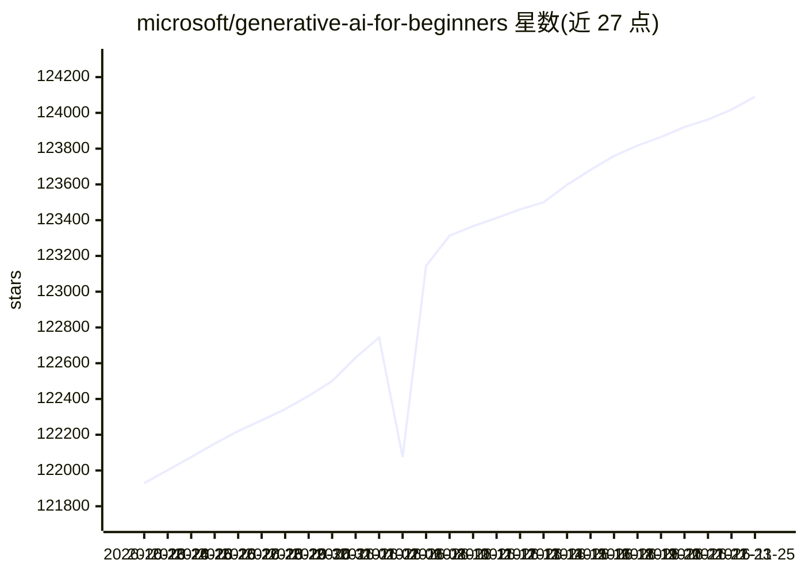

# microsoft/generative-ai-for-beginners

⭐ 124,091 · Jupyter Notebook · MIT · 推送 2026-11-19 · [GitHub](https://github.com/microsoft/generative-ai-for-beginners) · 组织维护

**面向初学者的生成式 AI 应用开发入门课程（21 课）**

由 Microsoft Cloud Advocates 制作的 21 课生成式 AI 课程，涵盖 LLM 基础、提示工程、文本/聊天/图像生成应用、RAG、向量数据库、function calling、AI Agent、微调与 SLM 等主题。课程分为讲解概念的 "Learn" 课与带 Python 和 TypeScript 代码示例的 "Build" 课，每课含视频介绍、书面讲义与延伸资源。运行示例需配合 Azure OpenAI Service、Microsoft Foundry Models、OpenAI API 或 Foundry Local。提供 50+ 语言翻译与 Discord 学习社区。

## 筛选速览

| 维度 | 判定 | 备注 |
|---|---|---|
| AI 角色 | `ai-knowledge` | 知识聚合/清单类 |
| 许可风险 | `permissive` | MIT |
| 部署形态 | `None` |  |
| 模型依赖 | — | README 未给出锁定关系 |
| 硬件要求 | — | 无带数字的原话,不猜 |
| 安装摩擦 | `low` | 无编译、无系统依赖或容器化 |
| 成熟度 | — | 结构信号不足 |

## 动量与使用信号

- 维护:`active` — 距上次 push 0.7 天,年发版 0,153 位贡献者
- 涨星:近 1 天 **+73**(自 20261016 起算)
- 平台:WINDOWS / MACOS / LINUX · 协议:OPENAI-API / MCP

## 能力要点

- 21 课覆盖从 LLM 概念到 RAG、Agent、微调的完整主题链
- Build 课提供 Python 与 TypeScript 双语言代码示例
- README 含 50+ 语言翻译，支持 sparse checkout 精简克隆
- 示例可运行于 Azure OpenAI、OpenAI API 或离线的 Foundry Local

## 适用场景

- 系统学习构建生成式 AI 应用的基础知识与代码实践
- 学习提示工程与 RAG 的动手示例
- 作为入门教程开展团队或课堂教学

## 场景标签

`教程课程` · 领域:学习与行业

## 证据(README 行号)

> L3: ### 21 Lessons teaching everything you need to know to start building Generative AI applications
> L45: Learn the fundamentals of building Generative AI applications with our 21-lesson comprehensive course by Microsoft 
> L51: Lessons are labeled either "Learn" lessons explaining a Generative AI concept or "Build" lessons that explain a con

## 星数曲线

2026-10-23 121,929 → 2026-11-25 124,091（+2,162）

---
*卡片 v1 · prompt 1.4 · 生成 2026-11-22 · 置信度 high · 依据 README sha `7af0425d3687` · [字段定义](../../DATASET.md)*
