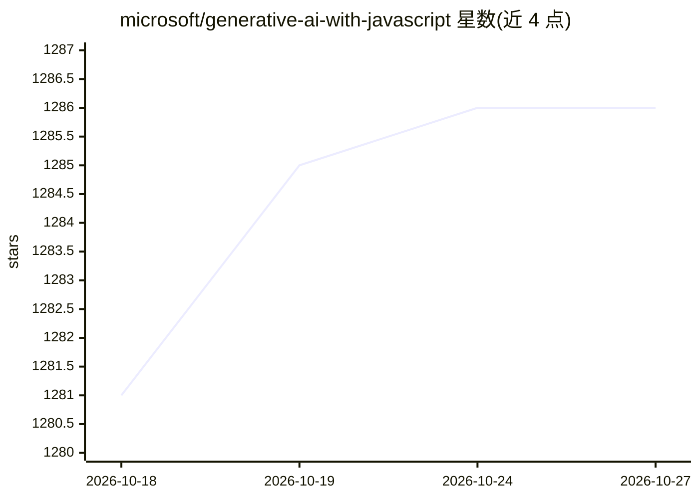

# microsoft/generative-ai-with-javascript

⭐ 1,286 · JavaScript · MIT · 推送 2026-10-26 · [GitHub](https://github.com/microsoft/generative-ai-with-javascript) · [官网](https://microsoft.github.io/generative-ai-with-javascript/) · 组织维护

**微软出品的 JavaScript 生成式 AI 入门课程（8 课）**

Microsoft 维护的面向 JavaScript 开发者的生成式 AI 教学课程，以“时间旅行与历史人物对话”为叙事主线，共 8 课，覆盖 LLM 基础、提示工程、结构化输出、RAG、工具调用与 MCP 等，每课含文字教程、作业、测验及答案。附带 companion app（在 app 目录），可与历史人物角色对话，支持 GitHub Codespaces 在线或本地运行；模型接入通过 Microsoft Foundry 项目部署聊天模型并配置 .env 中的端点与 API key，运行需 Node.js LTS。

## 筛选速览

| 维度 | 判定 | 备注 |
|---|---|---|
| AI 角色 | `ai-knowledge` | 知识聚合/清单类 |
| 许可风险 | `permissive` | MIT |
| 部署形态 | `None` |  |
| 模型依赖 | — | README 未给出锁定关系 |
| 硬件要求 | — | 无带数字的原话,不猜 |
| 安装摩擦 | `low` | 无编译、无系统依赖或容器化 |
| 成熟度 | — | 结构信号不足 |

## 能力要点

- 8 节课程覆盖 LLM 基础、提示工程、RAG、工具调用、MCP
- 每课含作业、测验及对应答案
- 可对话历史人物的 companion app（可本地运行或用 Codespaces）
- 新增 MCP 服务器构建与 LLM 客户端集成课程

## 适用场景

- JavaScript 开发者系统入门生成式 AI 开发
- 边学边跑代码示例与作业练习
- 动手体验 RAG、工具调用与 MCP 协议

## 场景标签

`教程课程` · 领域:学习与行业

## 证据(README 行号)

> L16: This course throws you into a *time-traveling adventure*—meet history’s legends with a fun twist, while learning Ge
> L78: |#|Lesson Link|Description|

## 星数曲线

2026-10-18 1,281 → 2026-10-27 1,286（+5）

---
*卡片 v1 · prompt 1.4 · 生成 2026-10-21 · 置信度 high · 依据 README sha `47971865d6a4` · [字段定义](../../DATASET.md)*
