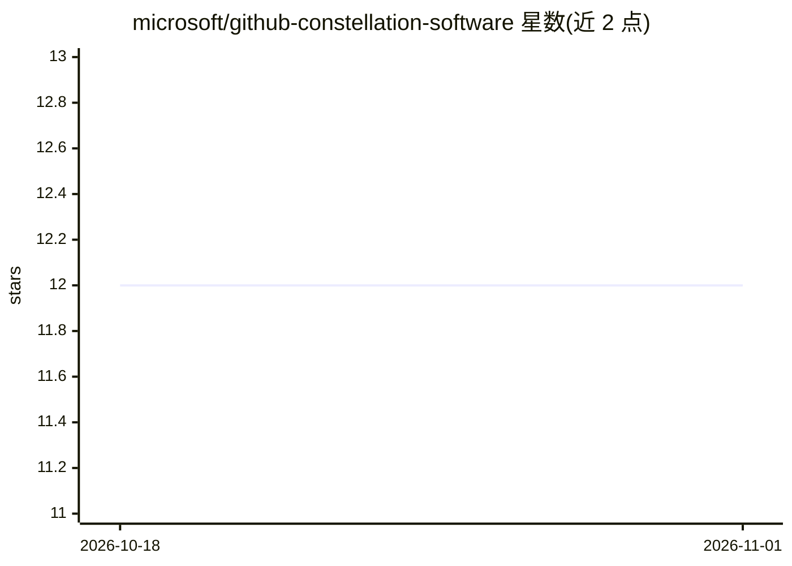

# microsoft/github-constellation-software

⭐ 12 · TypeScript · MIT · 推送 2026-10-26 · [GitHub](https://github.com/microsoft/github-constellation-software) · [官网](https://microsoft.github.io/github-constellation-software/) · 组织维护

**面向 CSI 旗下企业的 GitHub 与 Copilot 资源策展中心**

由 Microsoft 的 GitHub @ CSI 团队维护的公开资源枢纽，面向 Constellation Software Inc.（CSI）投资组合公司，汇集 GitHub、GitHub Copilot 与 Microsoft AI 赋能资源。内容按迁移、采用、规模化三个阶段组织：涵盖从 Bitbucket/Azure DevOps/GitLab/SVN 迁移到 GitHub、Agentic Workflows、治理与架构参考，以及 CSI 折扣的 Azure 计费方式、Copilot 用量计费指南和双周 Build Days 活动信息。属资源导览性质，不含可安装的软件本体。

## 筛选速览

| 维度 | 判定 | 备注 |
|---|---|---|
| AI 角色 | `ai-knowledge` | 知识聚合/清单类 |
| 许可风险 | `permissive` | MIT |
| 部署形态 | `None` |  |
| 模型依赖 | — | README 未给出锁定关系 |
| 硬件要求 | — | 无带数字的原话,不猜 |
| 安装摩擦 | `low` | 无编译、无系统依赖或容器化 |
| 成熟度 | — | 结构信号不足 |

## 能力要点

- 按迁移/采用/规模化三阶段组织的资源导览
- GitHub Enterprise 与 Copilot 的 CSI 折扣与 Azure 计费说明
- Copilot 用量计费（UBB）五步推广方案
- 治理与架构参考（Well-Architected、EMU、多 org 模式）

## 适用场景

- CSI 旗下公司规划从其他平台迁移到 GitHub
- 了解 GitHub Copilot 的计费与推广方案
- 查找规模化运行 GitHub 与 Copilot 的治理架构参考

## 场景标签

`精选清单` · 领域:学习与行业

## 证据(README 行号)

> L5: > A curated public hub of **GitHub**, **GitHub Copilot**, and **Microsoft AI
> L6: > enablement** resources for Constellation Software Inc. (CSI) portfolio
> L7: > companies — maintained by the **GitHub @ CSI team at Microsoft**.

## 星数曲线

2026-10-18 12 → 2026-11-01 12（+0）

---
*卡片 v1 · prompt 1.4 · 生成 2026-11-01 · 置信度 high · 依据 README sha `44419b9f18eb` · [字段定义](../../DATASET.md)*
