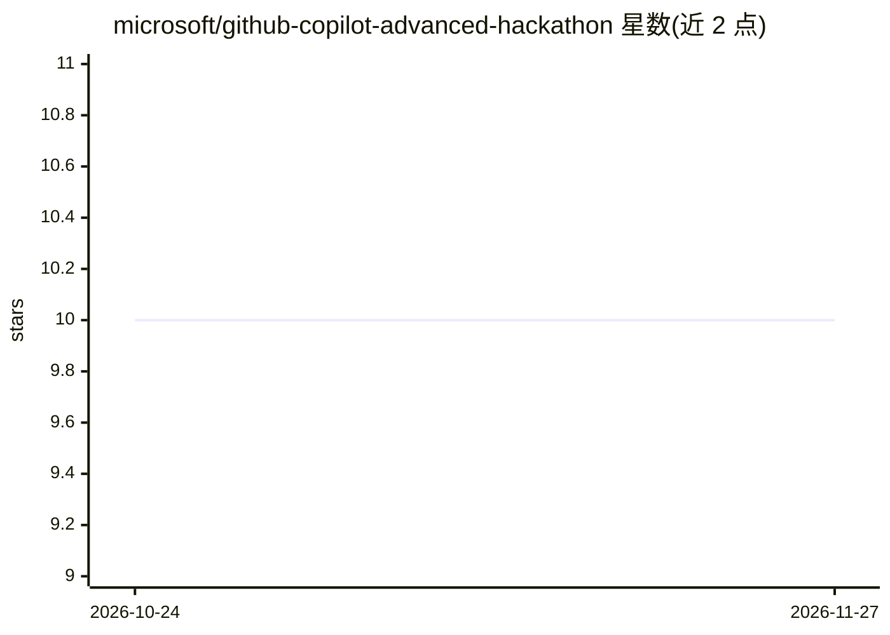

# microsoft/github-copilot-advanced-hackathon

⭐ 10 · HTML · MIT · 推送 2026-09-02 · [GitHub](https://github.com/microsoft/github-copilot-advanced-hackathon) · 组织维护

**面向开发者的 GitHub Copilot 规格驱动开发黑客松教程**

Microsoft 举办的编程挑战/工作坊材料，主题为基于 GitHub Copilot 的规格驱动开发。README 提供前置条件清单（Spec-Kit 的 specify CLI、NodeJS、Python UV、Git、.NET/Java/Python/TypeScript 之一），给出 specify CLI 在 Windows 与 macOS/Linux 的安装命令，并列出四种语言路线对应的示例仓库（eShop、Pet Clinic、InvenTree、ngLibrary）与支持 IDE。目标是通过 setup 工作流、需求理解、提示技巧三个环节练习高级 AI 编码工作流；结果因 AI 开发的非确定性而不同。

## 筛选速览

| 维度 | 判定 | 备注 |
|---|---|---|
| AI 角色 | `ai-knowledge` | 知识聚合/清单类 |
| 许可风险 | `permissive` | MIT |
| 部署形态 | `None` |  |
| 模型依赖 | — | README 未给出锁定关系 |
| 硬件要求 | — | 无带数字的原话,不猜 |
| 安装摩擦 | `medium` | 含编译或系统依赖之一 |
| 成熟度 | — | 结构信号不足 |

## 能力要点

- 提供 specify CLI（Spec-Kit）在 Windows/macOS/Linux 的固定版本安装命令
- 覆盖 .NET、Java、Python、TypeScript 四条语言学习路径及示例仓库
- 包含示例需求 Markdown 练习文件供参与者实现
- 工作坊设计为目标导向的自我探索，明示结果具有非确定性

## 适用场景

- 参加 GitHub Copilot 规格驱动开发黑客松前的环境准备
- 按所选语言路线克隆示例仓库并练习 AI 编码工作流
- 学习规格驱动开发的提示技巧与自定义指令用法

## 场景标签

`教程课程` · 领域:学习与行业

## 证据(README 行号)

> L3: # Scenario : Spec Driven Development Programming Challenge
> L98: In the Exercise Files folder, you'll find a series of Markdown files. These are just a few example requirements tha
> L121: This workshop is designed to be a goal-oriented self-exploration of Advanced AI Coding using GitHub Copilot. Your 

## 星数曲线

2026-10-24 10 → 2026-11-27 10（+0）

---
*卡片 v1 · prompt 1.4 · 生成 2026-11-19 · 置信度 high · 依据 README sha `6c80250d97c4` · [字段定义](../../DATASET.md)*
