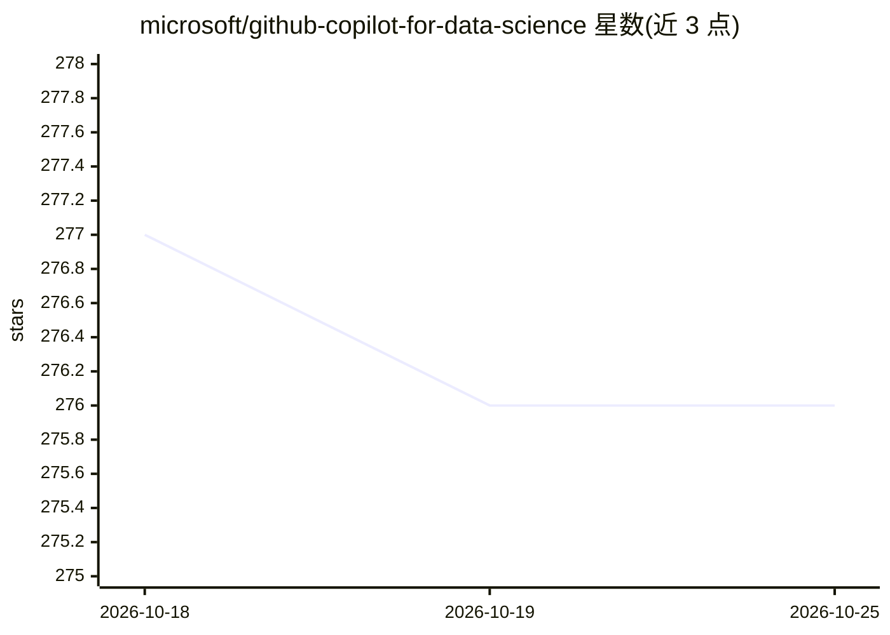

# microsoft/github-copilot-for-data-science

⭐ 276 · Jupyter Notebook · MIT · 推送 2026-04-26 · [GitHub](https://github.com/microsoft/github-copilot-for-data-science) · 组织维护

**面向数据科学者的 GitHub Copilot 高级功能教学工作坊**

微软维护的教学仓库：通过 workshop 形式讲解 GitHub Copilot 高级功能在 Python 与数据科学项目中的应用，内容涵盖斜杠命令、inline chat、@workspace 等 agent、Jupyter Notebook 中的交互、以及构建自定义 agent 加速数据科学流程。实践目标是构建一个处理 CSV 数据、导出高分辨率图形并生成可分享报告的 Jupyter notebook。唯一前置条件是公开 GitHub 账号，所有资源、依赖与数据均含于仓库内。

## 筛选速览

| 维度 | 判定 | 备注 |
|---|---|---|
| AI 角色 | `ai-knowledge` | 知识聚合/清单类 |
| 许可风险 | `permissive` | MIT |
| 部署形态 | `None` |  |
| 模型依赖 | — | README 未给出锁定关系 |
| 硬件要求 | — | 无带数字的原话,不猜 |
| 安装摩擦 | `low` | 无编译、无系统依赖或容器化 |
| 成熟度 | — | 结构信号不足 |

## 能力要点

- 覆盖斜杠命令、inline chat、@workspace 等高级功能
- 讲解如何构建加速数据科学项目的自定义 agent
- 实践项目：CSV 数据整理、高分辨率图形导出与报告生成
- 面向 Software Engineer / Data Engineer / Data Scientist 等角色

## 适用场景

- 我需要系统学习 Copilot 在数据科学项目中的用法
- 我想学会在 Jupyter Notebook 中使用 Copilot 交互
- 我想为数据科学流程定制自己的 agent

## 场景标签

`教程课程` · 领域:学习与行业

## 证据(README 行号)

> L12: - **What you'll learn**: You'll use advanced GitHub Copilot features and apply it to a project using Python, Jupyte
> L19: - Apply GitHub Copilot suggestions and interactions to a data science project, especially in Jupyter Notebooks

## 星数曲线

2026-10-18 277 → 2026-10-25 276（-1）

---
*卡片 v1 · prompt 1.4 · 生成 2026-10-22 · 置信度 high · 依据 README sha `943997bd8f84` · [字段定义](../../DATASET.md)*
