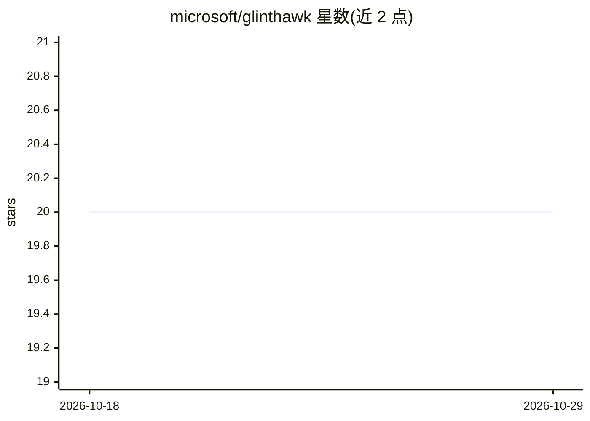

# microsoft/glinthawk

⭐ 20 · C++ · MIT · 推送 2026-03-30 · [GitHub](https://github.com/microsoft/glinthawk) · 组织维护

**C++ 编写的 Llama2 系列模型推理引擎**

由 Microsoft 维护的 LLM 推理引擎，用 C++ 实现且要求 C++20，针对 Llama2 模型家族。构建依赖 CMake、GCC>=12、OpenSSL、Protobuf 与 Google Logging；可选构建 CUDA 版本需 CUDA Toolkit 与兼容的 nvcc。提供源码编译安装（cmake+make），仅在 Ubuntu 22.04 及以上测试，使用部分 Linux 特有系统调用如 memfd_create。附 tools 目录脚本将 .bin 或原版 Llama2 模型转换为其自有格式，tinyllamas 可用于测试。

## 筛选速览

| 维度 | 判定 | 备注 |
|---|---|---|
| AI 角色 | `ai-ecosystem` | LLM/agent 周边工具 |
| 许可风险 | `permissive` | MIT |
| 部署形态 | `self-host` | docker 或自建部署 |
| 模型依赖 | — | README 未给出锁定关系 |
| 硬件要求 | — | 无带数字的原话,不猜 |
| 安装摩擦 | `low` | 无编译、无系统依赖或容器化 |
| 成熟度 | — | 结构信号不足 |

## 能力要点

- C++ 实现的 Llama2 模型族推理引擎
- 支持 CUDA 版本构建（需 CUDA Toolkit）
- 提供模型格式转换脚本（bin2glint.py 等）
- 提供 Dockerfile.amd64 与 Dockerfile.cuda 构建参考

## 适用场景

- 本地或服务器上运行 Llama2 家族模型推理
- 研究 PagedAttention 类推理引擎的实现
- 在 Ubuntu + CUDA 环境部署 LLM 推理服务

## 场景标签

`推理引擎` · 领域:训练与推理

## 证据(README 行号)

> L3: An inference engine for the Llama2 model family, written in C++.
> L29: Please adjust according to your setup as needed. Tested only on Ubuntu 22.04

## 星数曲线

2026-10-18 20 → 2026-10-29 20（+0）

---
*卡片 v1 · prompt 1.4 · 生成 2026-10-28 · 置信度 mid · 依据 README sha `61a13fda4c02` · [字段定义](../../DATASET.md)*
