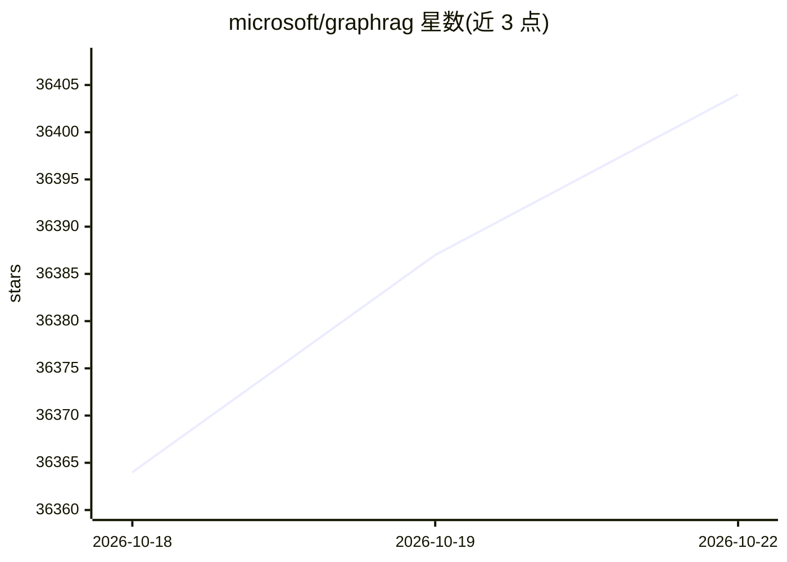

# microsoft/graphrag

⭐ 36,411 · Python · MIT · 推送 2026-10-20 · [GitHub](https://github.com/microsoft/graphrag) · [官网](https://microsoft.github.io/graphrag/) · 组织维护

**面向私有数据的图谱化 RAG 数据管线与研究系统**

微软研究院的 GraphRAG 项目：一条数据管线与转换工具集，用 LLM 从非结构化文本中抽取结构化数据，构建知识图谱作为问答的定向上下文。提供 CLI 快速上手、索引流程与提示词调优指南，经 PyPI 分发。README 标注为处于维护模式的科研项目，不再接受新 PR 或新功能，仅做缺陷修复与依赖更新；并提示索引操作成本可能较高，建议从小规模开始。

## 筛选速览

| 维度 | 判定 | 备注 |
|---|---|---|
| AI 角色 | `ai-native` | 本体是模型或模型工具 |
| 许可风险 | `permissive` | MIT |
| 部署形态 | `library` | 以包/库形式分发 |
| 模型依赖 | — | README 未给出锁定关系 |
| 硬件要求 | — | 无带数字的原话,不猜 |
| 安装摩擦 | `low` | 无编译、无系统依赖或容器化 |
| 成熟度 | — | 结构信号不足 |

## 动量与使用信号

- 维护:`active` — 距上次 push 5.4 天,年发版 15,51 位贡献者
- 涨星:近 1 天 **+9**(自 20261016 起算)

## 能力要点

- 用 LLM 从非结构化文本抽取结构化数据的数据管线
- 以知识图谱为问答构建定向上下文
- 提供 CLI 快速上手与大版本迁移笔记本
- 提供提示词调优指南与负责任 AI FAQ

## 适用场景

- 让 LLM 基于我的私有数据回答问题
- 对非结构化文本做结构化抽取与建图
- 按文档指引调优提示词以适配自有数据

## 场景标签

`RAG` `知识图谱` · 领域:知识与检索

## 证据(README 行号)

> L25: The GraphRAG project is a data pipeline and transformation suite that is designed to extract meaningful, structured
> L35: This repository presents a methodology for using knowledge graph memory structures to enhance LLM outputs. Please n
> L4: > GraphRAG is a research project that explores the functional use of graphs to form a targeted context for question 

## 星数曲线

2026-10-18 36,364 → 2026-10-22 36,404（+40）

---
*卡片 v1 · prompt 1.4 · 生成 2026-10-18 · 置信度 high · 依据 README sha `4a17ec876ce0` · [字段定义](../../DATASET.md)*
