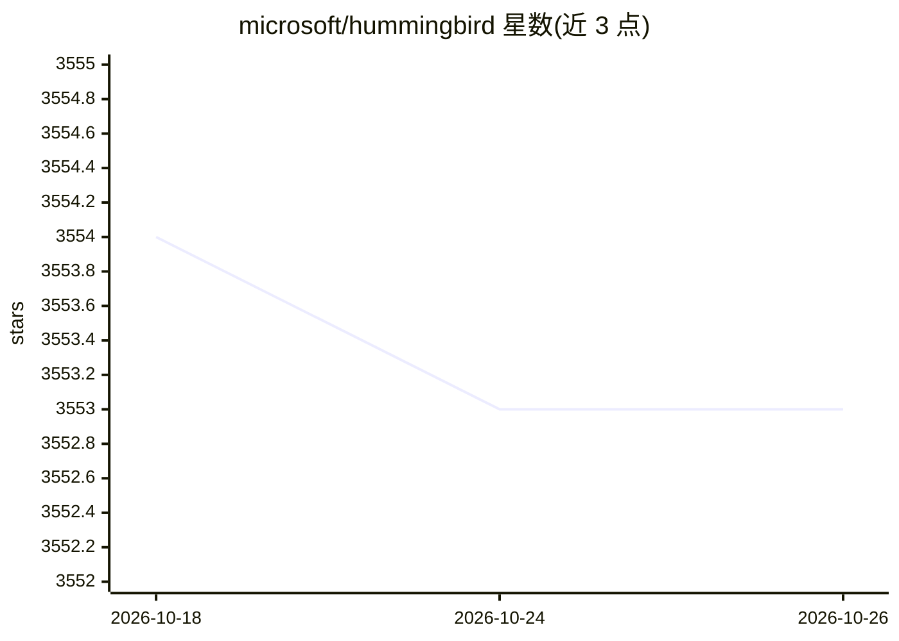

# microsoft/hummingbird

⭐ 3,553 · Python · MIT · 推送 2026-09-14 · [GitHub](https://github.com/microsoft/hummingbird) · 组织维护

**将训练好的传统 ML 模型编译为张量计算以加速推理的库**

微软开发的模型编译库：把已训练的 scikit-learn 决策树/随机森林、LightGBM、XGBoost 等传统 ML 模型转换为 PyTorch、TorchScript、ONNX、TVM 张量计算，从而利用神经网络框架的优化与硬件加速，无需重写模型。核心机制包括将决策树遍历改写为 GEMM 矩阵乘法等策略。提供遵循 sklearn API 的统一推理接口，可直接替换原模型；转出的 PyTorch/TorchScript 模型可通过 TorchServe 部署。Python 3.9-3.11 经测试，依赖 PyTorch>=1.6.0，通过 pip 安装，MIT 许可。面向希望加速传统 ML 推理的开发者。

## 筛选速览

| 维度 | 判定 | 备注 |
|---|---|---|
| AI 角色 | `ai-ecosystem` | LLM/agent 周边工具 |
| 许可风险 | `permissive` | MIT |
| 部署形态 | `library` | 以包/库形式分发 |
| 模型依赖 | — | README 未给出锁定关系 |
| 硬件要求 | — | 无带数字的原话,不猜 |
| 安装摩擦 | `low` | 无编译、无系统依赖或容器化 |
| 成熟度 | — | 结构信号不足 |

## 能力要点

- 将 sklearn/LightGBM/XGBoost 模型转换为 PyTorch/TorchScript/ONNX/TVM
- GEMM 等多种决策树张量化转换策略
- sklearn 风格统一推理 API，无需修改推理代码
- 可经 TorchServe 服务化部署

## 适用场景

- 把已上线的 sklearn/LightGBM 模型迁移到 GPU 或张量框架加速推理
- 统一平台同时服务传统 ML 与神经网络模型
- 将树模型导出为 ONNX/TorchScript 便于部署

## 场景标签

`推理引擎` · 领域:训练与推理

## 证据(README 行号)

> L10: *Hummingbird* is a library for compiling trained traditional ML models into tensor computations. *Hummingbird* allo
> L12: Currently, you can use *Hummingbird* to convert your trained traditional ML models into PyTorch, TorchScript, ONNX,
> L57: In general, Hummingbird syntax is very intuitive and minimal. To run your traditional ML model on DNN frameworks, y

## 星数曲线

2026-10-18 3,554 → 2026-10-26 3,553（-1）

---
*卡片 v1 · prompt 1.4 · 生成 2026-10-20 · 置信度 high · 依据 README sha `7b8c066ddfdf` · [字段定义](../../DATASET.md)*
