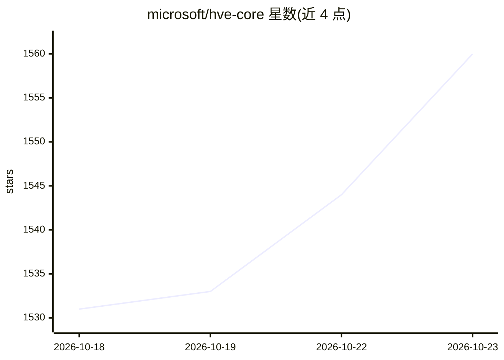

# microsoft/hve-core

⭐ 1,560 · PowerShell · MIT · 推送 2026-10-22 · [GitHub](https://github.com/microsoft/hve-core) · 组织维护

**面向 GitHub Copilot 的规范驱动 agentic SDLC 框架**

微软维护的 agentic 软件开发生命周期框架，以 agents、instructions、skills 形式向 GitHub Copilot 注入上下文：编码标准、约 80 项标准、安全要求、合规流程与架构评审等组织知识被编码进工作流，遵循 RPI（Research/Plan/Implement/Review）方法论。安装方式为 VS Code 扩展市场或 Copilot CLI 插件。README 明确声明其为快速演进、观点鲜明的框架，建议作为模式与学习来源而非稳定的生产依赖，接口可能不向后兼容。

## 筛选速览

| 维度 | 判定 | 备注 |
|---|---|---|
| AI 角色 | `ai-ecosystem` | LLM/agent 周边工具 |
| 许可风险 | `permissive` | MIT |
| 部署形态 | `None` |  |
| 模型依赖 | — | README 未给出锁定关系 |
| 硬件要求 | — | 无带数字的原话,不猜 |
| 安装摩擦 | `low` | 无编译、无系统依赖或容器化 |
| 成熟度 | `idea` | |

## 能力要点

- Agents/instructions/skills 三类可复用工作流构件，含斜杠命令入口
- 将编码标准、安全要求、合规流程、架构评审编码进开发工作流
- RPI 工作流方法论（Research/Plan/Implement/Review）
- 通过 VS Code 扩展市场或 Copilot CLI 插件安装

## 适用场景

- 在 GitHub Copilot 中引入团队统一的工程规范与上下文管理
- 把安全要求与合规流程前置到日常开发工作流
- 为新项目快速搭建规范驱动的 agentic 开发流程

## 场景标签

`编码 Agent` · 领域:编码与开发

## 证据(README 行号)

> L26: HVE Core is a highly opinionated agentic software development lifecycle (SDLC) framework. Its core value lies in co
> L34: * Agents for specialized tasks such as research, planning, implementation, and review
> L49: 2. Open any project and launch GitHub Copilot Chat (`Ctrl+Alt+I`).

## 星数曲线

2026-10-18 1,531 → 2026-10-23 1,560（+29）

---
*卡片 v1 · prompt 1.4 · 生成 2026-10-21 · 置信度 high · 依据 README sha `49a37f7ddb9a` · [字段定义](../../DATASET.md)*
