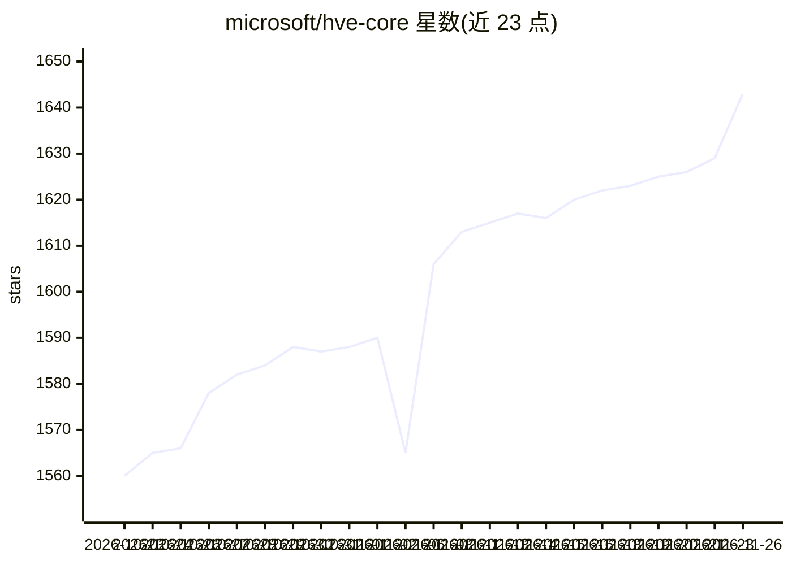

# microsoft/hve-core

⭐ 1,643 · PowerShell · MIT · 推送 2026-11-25 · [GitHub](https://github.com/microsoft/hve-core) · 组织维护

**面向 GitHub Copilot 用户的 SDLC 框架插件（agents/instructions/skills）**

Microsoft 出品的 agentic 软件开发生命周期（SDLC）框架，以插件形式安装在 VS Code 或 GitHub Copilot CLI 中。核心机制包括：上下文管理、治理、约 80 项标准的编码化、可复用的组织知识，以及 RPI（Research, Plan, Implement, Review）工作流；提供研究/规划/实现/评审等专用 agents、自动应用编码标准的 instructions、含斜杠命令入口的 skills。README 明示框架处于快速演进状态，接口可能发生不向后兼容的变更，建议作为模式与学习来源而非生产依赖。MIT 许可，部分源自 OWASP 的 skill 内容为 CC BY-SA 4.0。

## 筛选速览

| 维度 | 判定 | 备注 |
|---|---|---|
| AI 角色 | `ai-ecosystem` | LLM/agent 周边工具 |
| 许可风险 | `permissive` | MIT |
| 部署形态 | `None` |  |
| 模型依赖 | — | README 未给出锁定关系 |
| 硬件要求 | — | 无带数字的原话,不猜 |
| 安装摩擦 | `low` | 无编译、无系统依赖或容器化 |
| 成熟度 | `idea` | |

## 能力要点

- 提供 agents/instructions/skills 三类结构化工作流构件
- RPI 工作流（Research, Plan, Implement, Review）
- 内置约 80 项标准、安全与合规流程的编码化
- 支持 VS Code 插件与 GitHub Copilot CLI 两种安装路径

## 适用场景

- 为团队统一接入基于 GitHub Copilot 的标准化开发工作流
- 将安全要求与合规流程自动带入工程任务
- 组织级推广统一的编码标准与评审实践

## 场景标签

`Agent 框架` `编码 Agent` `代码审查` · 领域:Agent 开发

## 证据(README 行号)

> L26: HVE Core is a highly opinionated agentic software development lifecycle (SDLC) framework. Its core value lies in co
> L34: * Agents for specialized tasks such as research, planning, implementation, and review
> L46: 1. Install the `hve-core` plugin. In VS Code, run **Chat: Open Customizations**, select **Browse**, add the `micros

## 星数曲线

2026-10-23 1,560 → 2026-11-26 1,643（+83）

---
*卡片 v1 · prompt 1.4 · 生成 2026-11-23 · 置信度 high · 依据 README sha `2326a020a2ce` · [字段定义](../../DATASET.md)*
