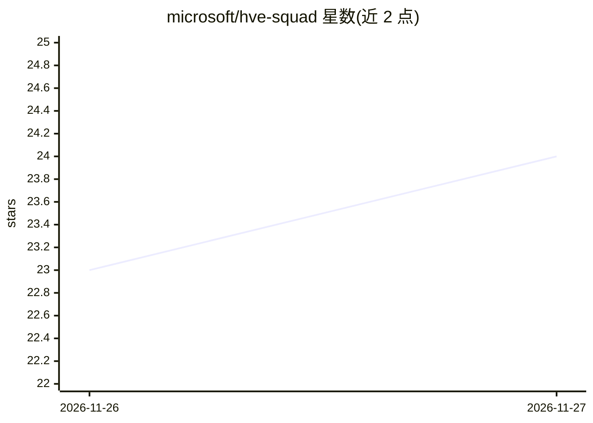

# microsoft/hve-squad

⭐ 24 · PowerShell · MIT · 推送 2026-11-26 · [GitHub](https://github.com/microsoft/hve-squad) · [官网](https://microsoft.github.io/hve-squad/) · 组织维护

**面向 Copilot 环境的多 Agent 协作插件：分发请求并行执行**

GitHub Copilot 插件，将固定版本的 HVE Core Agent 阵容连同 skills、规则与 hooks 打包为可安装单元，并提供 Squad Coordinator 将用户请求路由给多个 Agent 并行处理。支持 VS Code、Copilot CLI 与 Copilot App 三种宿主；附带 Squad Coach 咨询型 Agent（只读不改动状态）与面向非技术用户的 Studio 画布面板。提供成本上限（cost-ceiling）与按角色模型路由（routing=）机制，APM 包作为仓库本地回退安装方式。各平台前置要求 PowerShell 7+。

## 筛选速览

| 维度 | 判定 | 备注 |
|---|---|---|
| AI 角色 | `ai-ecosystem` | LLM/agent 周边工具 |
| 许可风险 | `permissive` | MIT |
| 部署形态 | `None` |  |
| 模型依赖 | — | README 未给出锁定关系 |
| 硬件要求 | — | 无带数字的原话,不猜 |
| 安装摩擦 | `low` | 无编译、无系统依赖或容器化 |
| 成熟度 | — | 结构信号不足 |

## 能力要点

- Squad Coordinator 将请求路由给多个 Agent 并行处理
- Squad Coach 只读咨询 Agent，输出来源引用的 runbook
- cost-ceiling 成本上限与 routing= 四种模型路由模式
- HVE Squad Studio 卡片式画布，免聊天语法操作

## 适用场景

- 在 VS Code/Copilot CLI 中用多 Agent 协作完成开发任务
- 非技术用户通过画布界面引导完成构建流程
- 为团队设置模型选择策略与消费上限

## 场景标签

`多智能体` `编码 Agent` · 领域:Agent 开发

## 证据(README 行号)

> L2: description: A GitHub Copilot plugin composing HVE Core and HVE Squad agents, skills, rules, and hooks.
> L8:  A GitHub Copilot plugin that bundles the pinned HVE Core cast with HVE Squad agents, skills, rules,
> L9:  and hooks, and ships a Squad Coordinator that routes your request to agents in parallel.

## 星数曲线

2026-11-26 23 → 2026-11-27 24（+1）

---
*卡片 v1 · prompt 1.4 · 生成 2026-11-26 · 置信度 high · 依据 README sha `9d7e497c12e4` · [字段定义](../../DATASET.md)*
