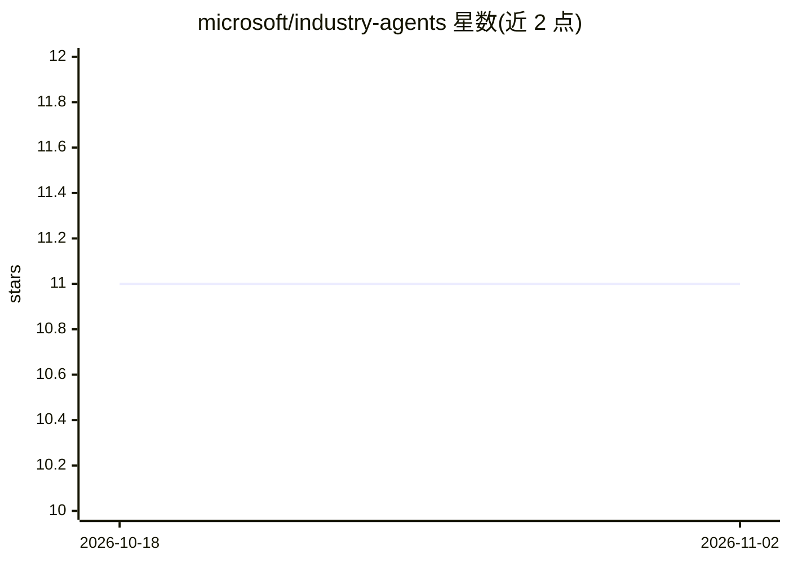

# microsoft/industry-agents

⭐ 11 · PowerShell · MIT · 推送 2026-05-12 · [GitHub](https://github.com/microsoft/industry-agents) · 组织维护

**面向行业的 Copilot Studio Agent 可复用模板集合**

微软 FAST 生态下的行业智能体模板库：提供面向 Power Platform Copilot Studio 的标准化、可复用 Agent 模块，覆盖行政、合规安全、财务、政府、运营、人力等 8 个领域类别。每个模块包含 Copilot Studio 机器人定义文件、主题对话流、动作配置与集成、知识源引用、BUILD.md 文档及 PowerShell 部署脚本。README 声明这些模板为参考实现，不设计为直接投入生产，部署前需自行适配、纳入 ALM 流程并完成安全合规审查。MIT 许可，按'现状'提供，不属官方支持产品。

## 筛选速览

| 维度 | 判定 | 备注 |
|---|---|---|
| AI 角色 | `ai-ecosystem` | LLM/agent 周边工具 |
| 许可风险 | `permissive` | MIT |
| 部署形态 | `None` |  |
| 模型依赖 | — | README 未给出锁定关系 |
| 硬件要求 | — | 无带数字的原话,不猜 |
| 安装摩擦 | `low` | 无编译、无系统依赖或容器化 |
| 成熟度 | — | 结构信号不足 |

## 能力要点

- 按 8 个行业领域类别组织的 Copilot Studio Agent 模板
- 模块含主题定义、动作配置、知识源与 PowerShell 部署脚本
- 自我声明为参考实现，不设计为直接生产部署
- 属 FAST 生态，配套 industry-apps / industry-solutions 等仓库

## 适用场景

- 组织为常见业务流程快速搭建对话式 AI Agent 的起点
- 学习 Copilot Studio Agent 的主题、动作与知识源组织方式
- 解决方案构建者扩展出生产就绪的行业对话 AI 方案

## 场景标签

`聊天机器人` `教程课程` · 领域:对话与助手

## 证据(README 行号)

> L1: # FAST Agents - App & AI Starter Templates
> L3: Welcome to FAST (App & AI Starter Templates), a collection of standardized, reusable Copilot Studio agent templates 

## 星数曲线

2026-10-18 11 → 2026-11-02 11（+0）

---
*卡片 v1 · prompt 1.4 · 生成 2026-11-02 · 置信度 high · 依据 README sha `e408729701a7` · [字段定义](../../DATASET.md)*
