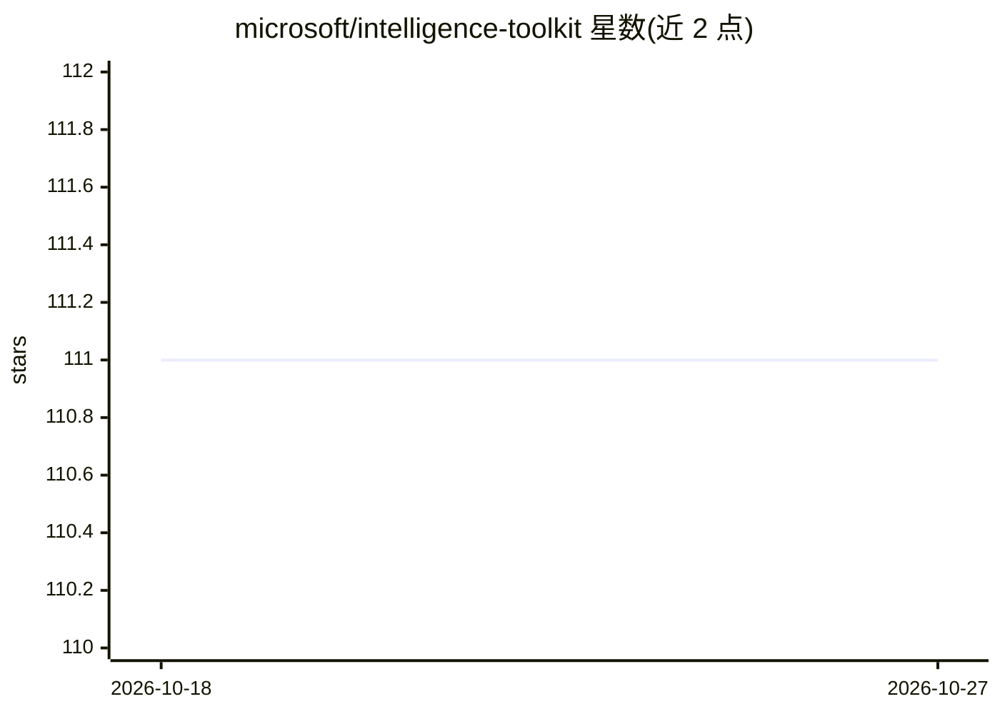

# microsoft/intelligence-toolkit

⭐ 111 · Python · MIT · 推送 2026-10-21 · [GitHub](https://github.com/microsoft/intelligence-toolkit) · 组织维护

**供领域专家从案例/实体/文本数据生成 AI 情报报告的交互式工作流套件**

微软维护的交互式工作流套件，面向熟悉数据的领域专家，覆盖案例、实体、文本三类数据的情报任务：差分隐私匿名化、模式检测与分组比较、模糊实体匹配与风险网络检测、文本查询与结构化抽取等，由 GPT-4（OpenAI 或 Azure OpenAI API）生成报告。以 Docker Web 应用、Azure 部署或 PyPI Python 包提供。限制：面向中等规模数据（数十万记录/数百 PDF），仅设计与测试英文数据，不得用于识别评估个人或高监管领域。

## 筛选速览

| 维度 | 判定 | 备注 |
|---|---|---|
| AI 角色 | `ai-native` | 本体是模型或模型工具 |
| 许可风险 | `permissive` | MIT |
| 部署形态 | `desktop` | 安装包/桌面程序 |
| 模型依赖 | locked-api |  |
| 硬件要求 | — | 无带数字的原话,不猜 |
| 安装摩擦 | `low` | 无编译、无系统依赖或容器化 |
| 成熟度 | — | 结构信号不足 |

## 能力要点

- 9 类工作流覆盖案例/实体/文本数据的模式、关系与风险分析
- 使用 GPT-4（OpenAI/Azure OpenAI API）生成情报报告
- Anonymize Case Data 生成差分隐私数据集
- 支持 Docker Web 应用、Azure 部署与 PyPI 包三种运行方式

## 适用场景

- 对敏感案例记录做匿名化后检测数据模式以支持政策分析
- 跨数据集模糊匹配实体并分析关联网络的风险暴露
- 从大量非结构化文本中检索信息并总结主题生成报告

## 场景标签

`数据分析` `文档解析` · 领域:效率与自动化

## 证据(README 行号)

> L13: The Intelligence Toolkit is a suite of interactive workflows for creating AI intelligence reports from real-world d
> L23: The Intelligence Toolkit aims to help domain experts make sense of real-world data at a speed and scale that wouldn
> L37: The Intelligence Toolkit is designed to be used by domain experts who are familiar with the data and the intelligen

## 星数曲线

2026-10-18 111 → 2026-10-27 111（+0）

---
*卡片 v1 · prompt 1.4 · 生成 2026-10-23 · 置信度 high · 依据 README sha `3366f8db671a` · [字段定义](../../DATASET.md)*
