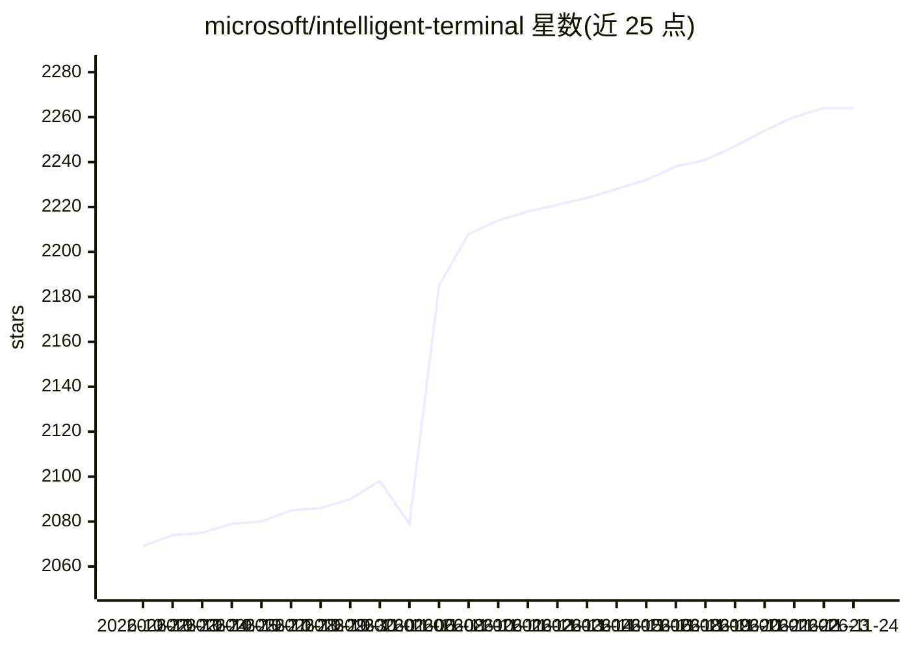

# microsoft/intelligent-terminal

⭐ 2,264 · C++ · MIT · 推送 2026-11-20 · [GitHub](https://github.com/microsoft/intelligent-terminal) · [官网](https://devblogs.microsoft.com/commandline/announcing-intelligent-terminal-version-0-1/) · 组织维护

**带原生 Agent 集成的 Windows Terminal 实验性分支**

Windows Terminal 的实验性分支，保留标签页、配置文件、主题、Shell 与快捷键等原有功能，并新增 agent 面板：兼容任何支持 Agent Client Protocol (ACP) 的 agent CLI，可感知所有 Shell（PowerShell、Bash/WSL）的输出上下文，建议命令需用户显式批准运行。支持自定义快捷键、错误检测（可自动发送失败上下文给 agent）、会话管理、token 用量显示、BYOK 自定义端点，API key 存于 Windows 凭据管理器。安装途径包括 Microsoft Store、WinGet 与 App Installer，要求 Windows 10 2004 (19041) 或更高版本。

## 筛选速览

| 维度 | 判定 | 备注 |
|---|---|---|
| AI 角色 | `ai-enhanced` | 去掉 AI 部分产品仍成立 |
| 许可风险 | `permissive` | MIT |
| 部署形态 | `None` |  |
| 模型依赖 | local-ok | 支持本地模型 |
| 硬件要求 | — | 无带数字的原话,不猜 |
| 安装摩擦 | `low` | 无编译、无系统依赖或容器化 |
| 成熟度 | `idea` | |

## 能力要点

- 兼容任意 ACP 协议的 agent CLI，自动检测本机 agent（Copilot/Claude/Codex/Gemini/OpenCode/Antigravity）
- agent 面板感知全部 Shell 输出上下文，命令执行需用户显式批准
- BYOK 自定义端点：OpenAI 兼容 Chat Completions 接口，支持无 key 的本地 Ollama 端点
- 错误检测与自动修复、会话管理、token 用量与成本显示

## 适用场景

- 在命令行中直接与 AI agent 对话排障，无需复制粘贴 Shell 输出
- 为不同 profile（含 WSL 发行版内）配置不同的 agent
- 接入本地模型端点进行离线/私有化的 agent 会话
- 管理多个并行 agent 会话并查看历史会话

## 场景标签

`AI 助手` · 领域:对话与助手

## 证据(README 行号)

> L13: Intelligent Terminal is an experimental fork of Windows Terminal with native agent integration.
> L15: Intelligent Terminal works with any Agent Client Protocol (ACP)-compatible agent CLI. All you need is to install yo
> L17: Intelligent Terminal takes all the features you love in Windows Terminal such as: tabs, profiles, themes, settings,

## 星数曲线

2026-10-22 2,069 → 2026-11-24 2,264（+195）

---
*卡片 v1 · prompt 1.4 · 生成 2026-11-23 · 置信度 high · 依据 README sha `e0d2adeae2de` · [字段定义](../../DATASET.md)*
