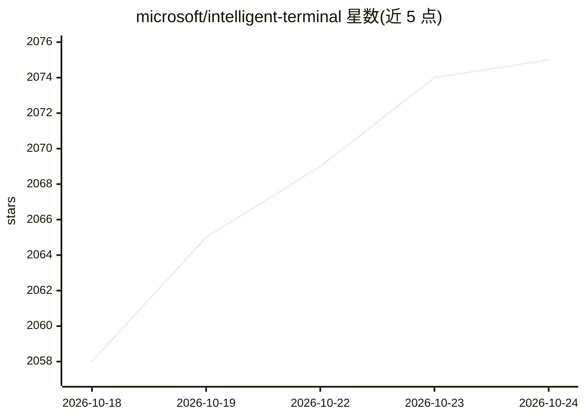

# microsoft/intelligent-terminal

⭐ 2,075 · C++ · MIT · 推送 2026-10-23 · [GitHub](https://github.com/microsoft/intelligent-terminal) · [官网](https://devblogs.microsoft.com/commandline/announcing-intelligent-terminal-version-0-1/) · 组织维护

**带原生 Agent 集成的 Windows Terminal 实验性分支**

微软维护的 Windows Terminal 分支，在终端中内置 Agent 窗格、Agent 状态栏、会话管理与命令面板提示等能力。通过 Agent Client Protocol (ACP) 兼容任意 agent CLI，首次启动自动检测已装的 Copilot/Claude/Codex/Gemini/OpenCode 等，默认 GitHub Copilot CLI。支持 BYOK 自定义 provider（OpenAI 兼容端点，含本地 Ollama 无 key 端点）、错误检测与修复建议、斜杠命令。要求 Windows 10 2004 及以上，经 Microsoft Store/WinGet/安装包分发，README 标注为实验性 fork。

## 筛选速览

| 维度 | 判定 | 备注 |
|---|---|---|
| AI 角色 | `ai-enhanced` | 去掉 AI 部分产品仍成立 |
| 许可风险 | `permissive` | MIT |
| 部署形态 | `None` |  |
| 模型依赖 | local-ok | 支持本地模型 |
| 硬件要求 | — | 无带数字的原话,不猜 |
| 安装摩擦 | `low` | 无编译、无系统依赖或容器化 |
| 成熟度 | `idea` | |

## 能力要点

- ACP 协议兼容任意 agent CLI，自动检测多个已装 agent
- Agent 窗格可读取 shell 输出上下文，命令执行需用户批准
- BYOK 自定义 provider（OpenAI 兼容端点，支持本地 Ollama）
- 错误自动检测、/fix 诊断建议与 token 用量显示

## 适用场景

- 在终端里直接向 agent 提问并让其解释命令错误
- 把本地 Ollama 模型接入终端 agent 窗格
- 跨多个 agent CLI（Copilot/Claude/Codex/Gemini 等）在同一终端内切换使用

## 场景标签

`编码 Agent` · 领域:编码与开发

## 证据(README 行号)

> L13: Intelligent Terminal is an experimental fork of Windows Terminal with native agent integration.
> L15: Intelligent Terminal works with any Agent Client Protocol (ACP)-compatible agent CLI. All you need is to install yo
> L81: |Agent and model|GitHub Copilot (default), or any ACP-compatible agent CLI, including custom or local agents. Confi

## 星数曲线

2026-10-18 2,058 → 2026-10-24 2,075（+17）

---
*卡片 v1 · prompt 1.4 · 生成 2026-10-21 · 置信度 high · 依据 README sha `8303c2b7a9c7` · [字段定义](../../DATASET.md)*
