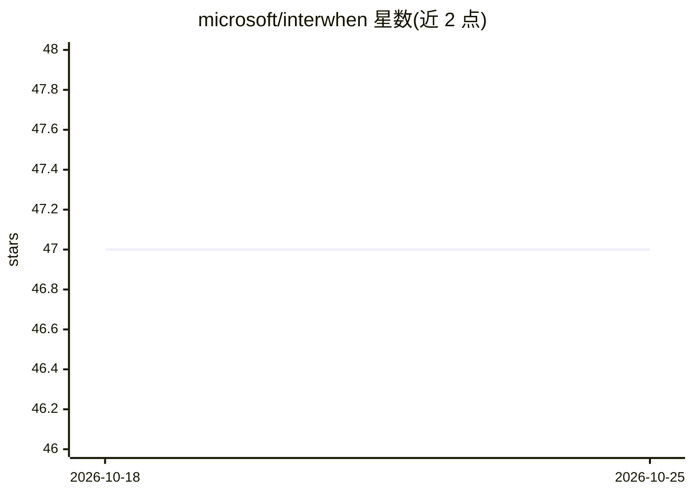

# microsoft/interwhen

⭐ 47 · Python · MIT · 推送 2026-07-15 · [GitHub](https://github.com/microsoft/interwhen) · 组织维护

**语言模型测试时验证框架：生成过程中核验推理轨迹合规性**

由 Microsoft 维护的 test-time 验证框架：在语言模型生成过程中，通过 Monitor 读取输出流、按触发点 fork 推理以获取中间状态，异步调用符号/神经/神经符号混合的 verifier 检查推理步骤；检测到违规时可注入纠正反馈、转向或中止生成。离线阶段可从自然语言策略文档自动合成基于代码的验证器，支持生成 Lean 形式化规范及机器检查的可靠性与完备性证明。提供单轨迹与 K-stable（早停）两类 Monitor，覆盖 Maze、Game of 24、ZebraLogic 等 5 个数据集示例。需 Python 3.10+，源码安装，目标 LLM 通过 vLLM 等服务器接入。

## 筛选速览

| 维度 | 判定 | 备注 |
|---|---|---|
| AI 角色 | `ai-ecosystem` | LLM/agent 周边工具 |
| 许可风险 | `permissive` | MIT |
| 部署形态 | `library` | 以包/库形式分发 |
| 模型依赖 | local-ok | 支持本地模型 |
| 硬件要求 | — | 无带数字的原话,不猜 |
| 安装摩擦 | `low` | 无编译、无系统依赖或容器化 |
| 成熟度 | — | 结构信号不足 |

## 能力要点

- 生成过程中验证中间推理步骤，违规时可转向/纠正/中止
- 从自然语言策略文档自动合成代码验证器，支持 Z3/Lean/编译器/Python 多种类型
- 验证器异步执行，仅在违规时干预
- K-stable Monitor 通过连续 k 次相同答案判定收敛，实现早停省算力

## 适用场景

- 高风险 agent 工作流中拦截不可逆工具调用前的策略违规
- 为推理模型增加测试时验证算力以提升实例级可靠性
- 评测与开发 verifier 设计（如奖励模型或 critic 前的测试台）

## 场景标签

`模型评测` · 领域:评测与运维

## 证据(README 行号)

> L17: interwhen is a test-time verification framework for language models that enforces correctness with respect to a set
> L21: interwhen addresses the problem by providing a plug-and-play mechanism to improve instance-level reliability of any
> L51: interwhen changes the inference pipeline of a language model by creating an auxiliary Monitor that runs alongside t

## 星数曲线

2026-10-18 47 → 2026-10-25 47（+0）

---
*卡片 v1 · prompt 1.4 · 生成 2026-10-25 · 置信度 mid · 依据 README sha `21a1cf03606a` · [字段定义](../../DATASET.md)*
