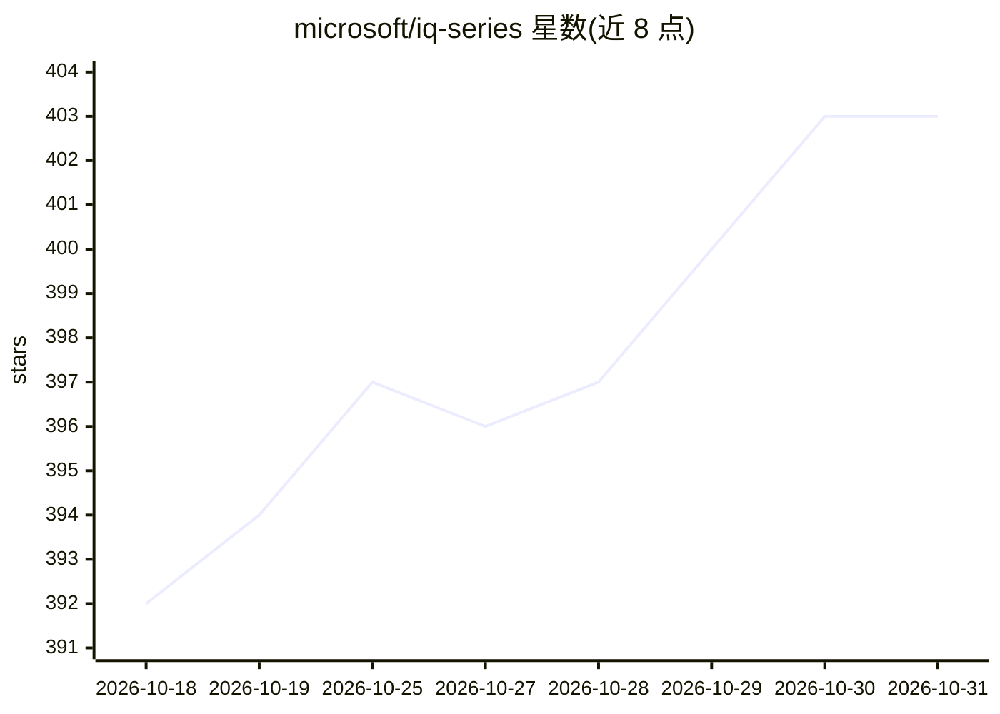

# microsoft/iq-series

⭐ 403 · Jupyter Notebook · MIT · 推送 2026-10-23 · [GitHub](https://github.com/microsoft/iq-series) · [官网](https://aka.ms/iq-series) · 组织维护

**Microsoft IQ 企业智能层的学习教程系列：视频+Notebook 实操**

Microsoft 官方出品的动手学习项目，围绕 Microsoft IQ 企业智能层（Foundry IQ 知识层、Work IQ 组织智能、Fabric IQ 业务语义、Web IQ 网页接地）组织教学。每集包含约 17 分钟的视频节目与配套 Jupyter notebook cookbook 或 markdown 实验指引，覆盖知识源数据管道、多源知识库查询、A2A/MCP 协议与 Copilot CLI 工具链。完成全部 cookbook/lab 可申请 Global AI Community 徽章；Fabric IQ 与 Web IQ 部分标注即将推出。

## 筛选速览

| 维度 | 判定 | 备注 |
|---|---|---|
| AI 角色 | `ai-knowledge` | 知识聚合/清单类 |
| 许可风险 | `permissive` | MIT |
| 部署形态 | `None` |  |
| 模型依赖 | — | README 未给出锁定关系 |
| 硬件要求 | — | 无带数字的原话,不猜 |
| 安装摩擦 | `low` | 无编译、无系统依赖或容器化 |
| 成熟度 | — | 结构信号不足 |

## 能力要点

- 视频节目 + Jupyter notebook cookbook / markdown lab 的分集结构
- Foundry IQ 三集（组件架构、知识源管道、多源知识库查询）已上线
- Work IQ 三集覆盖 REST/A2A/MCP 协议与 GitHub Copilot CLI 集成
- 完成实操后可申请 Global AI Community 徽章

## 适用场景

- 系统学习 Microsoft IQ 四大智能服务的架构与用法
- 跟做 notebook 实操，掌握 Foundry IQ 知识库与 Work IQ MCP 工具链
- 企业 AI agent 开发者了解知识层与协议策略设计

## 场景标签

`教程课程` · 领域:学习与行业

## 证据(README 行号)

> L24: |**Episode**|**Description**|**Video**|**Cookbook/Lab**|
> L43: Episode folders also include Jupyter notebook cookbooks or markdown lab instructions with hands-on and step-by-step

## 星数曲线

2026-10-18 392 → 2026-10-31 403（+11）

---
*卡片 v1 · prompt 1.4 · 生成 2026-10-21 · 置信度 high · 依据 README sha `78e5ffb034c0` · [字段定义](../../DATASET.md)*
