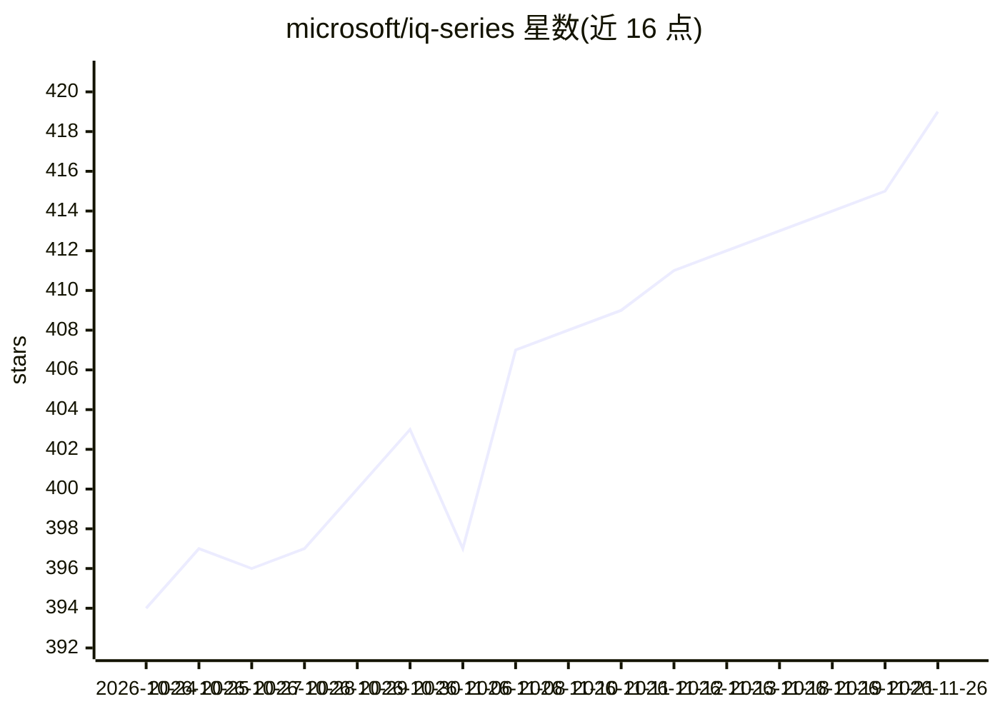

# microsoft/iq-series

⭐ 419 · Jupyter Notebook · MIT · 推送 2026-11-17 · [GitHub](https://github.com/microsoft/iq-series) · [官网](https://aka.ms/iq-series) · 组织维护

**学习 Microsoft IQ 企业智能层的教学系列：视频+notebook+实验**

微软官方出品的 Microsoft IQ 学习系列，覆盖 Fabric IQ、Foundry IQ、Work IQ 与 Web IQ 四项企业级智能服务。内容形式为视频剧集配 Jupyter notebook cookbook 或 markdown 实验指引，逐集讲解知识接入、数据管道、多源知识库查询、A2A 与 MCP 协议、实时网络检索 grounding 等主题。完成 cookbook/实验可向 Global AI Community 申请社区徽章；Foundry IQ、Work IQ、Web IQ 内容已发布，Fabric IQ 剧集标注即将推出。

## 筛选速览

| 维度 | 判定 | 备注 |
|---|---|---|
| AI 角色 | `ai-knowledge` | 知识聚合/清单类 |
| 许可风险 | `permissive` | MIT |
| 部署形态 | `None` |  |
| 模型依赖 | — | README 未给出锁定关系 |
| 硬件要求 | — | 无带数字的原话,不猜 |
| 安装摩擦 | `low` | 无编译、无系统依赖或容器化 |
| 成熟度 | — | 结构信号不足 |

## 能力要点

- 视频剧集 + Jupyter notebook cookbook + markdown 实验的成套学习材料
- 覆盖 Foundry IQ、Work IQ、Web IQ，Fabric IQ 内容标注即将推出
- 完成实验可申请 Global AI Community 颁发的社区徽章
- Work IQ 系列讲解 REST、A2A、MCP 协议与 Copilot CLI 工具化

## 适用场景

- 系统学习如何为企业 agent 接入 Foundry IQ 知识层
- 按 cookbook 动手搭建多源知识库查询管道
- 了解 Work IQ 的 MCP/A2A 协议策略与工具集成
- 为 agent 接入实时网络检索并生成带引用的回答

## 场景标签

`教程课程` · 领域:学习与行业

## 证据(README 行号)

> L5: Learn Microsoft IQ with The IQ Series! Microsoft IQ is Microsoft's unified intelligence layer for the enterprise, gi
> L43: Episode folders also include Jupyter notebook cookbooks or markdown lab instructions with hands-on and step-by-step
> L47: Complete an IQ's cookbooks or labs to earn its community badge. Badges are issued by the Global AI Community, so pl

## 星数曲线

2026-10-24 394 → 2026-11-26 419（+25）

---
*卡片 v1 · prompt 1.4 · 生成 2026-11-25 · 置信度 high · 依据 README sha `077ec78784ce` · [字段定义](../../DATASET.md)*
