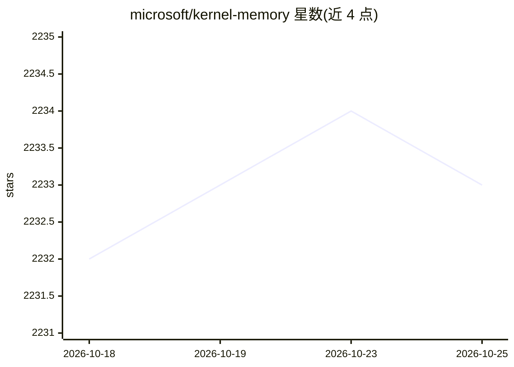

# microsoft/kernel-memory

⭐ 2,233 · C# · MIT · 推送 2026-06-08 · [GitHub](https://github.com/microsoft/kernel-memory) · 组织维护

**面向 AI 应用的记忆/RAG 索引服务，支持数据管道与引用式问答**

微软的已归档研究项目：提供多模态数据索引与 RAG 记忆方案，通过抽取、分块、向量化、存储的连续管道处理文档，支持自然语言提问并返回带引用与来源链接的回答。可部署为 Web 服务、Docker 容器、ChatGPT/Copilot/Semantic Kernel 插件，或以 .NET 库（MemoryServerless）嵌入进程内使用；扩展覆盖 Azure OpenAI/OpenAI/Ollama/Anthropic 等 LLM 与多种向量库和存储。README 声明代码为学习资源，非正式支持产品，仓库已归档。

## 筛选速览

| 维度 | 判定 | 备注 |
|---|---|---|
| AI 角色 | `ai-ecosystem` | LLM/agent 周边工具 |
| 许可风险 | `permissive` | MIT |
| 部署形态 | `self-host` | docker 或自建部署 |
| 模型依赖 | local-ok | 支持本地模型 |
| 硬件要求 | — | 无带数字的原话,不猜 |
| 安装摩擦 | `low` | 无编译、无系统依赖或容器化 |
| 成熟度 | `idea` | |

## 能力要点

- 抽取/分块/向量化/存储的可定制摄入管道，支持 Python/TypeScript/Java 自定义步骤
- 同步 serverless 内嵌与异步 Web 服务两种运行模式
- 回答自带引用、相关来源与 token 用量报告
- 扩展支持多种 LLM、向量库、文件存储与队列

## 适用场景

- 为应用接入带引用溯源的文档问答（RAG）能力
- 大规模异步导入文档并建立可检索的语义记忆
- 按用户标签过滤实现私有数据的权限隔离检索

## 场景标签

`RAG` `文档问答` · 领域:知识与检索

## 证据(README 行号)

> L12: **Kernel Memory** (KM) is a **multi-modal AI Service** specialized
> L13: in the efficient indexing of datasets through custom continuous data hybrid pipelines, with support
> L14: for **Retrieval Augmented Generation**
> L322: - **AI**: Azure OpenAI, OpenAI, ONNX, Ollama, Anthropic, Azure AI Document Intelligence, Azure AI

## 星数曲线

2026-10-18 2,232 → 2026-10-25 2,233（+1）

---
*卡片 v1 · prompt 1.4 · 生成 2026-10-21 · 置信度 high · 依据 README sha `622eb6997005` · [字段定义](../../DATASET.md)*
