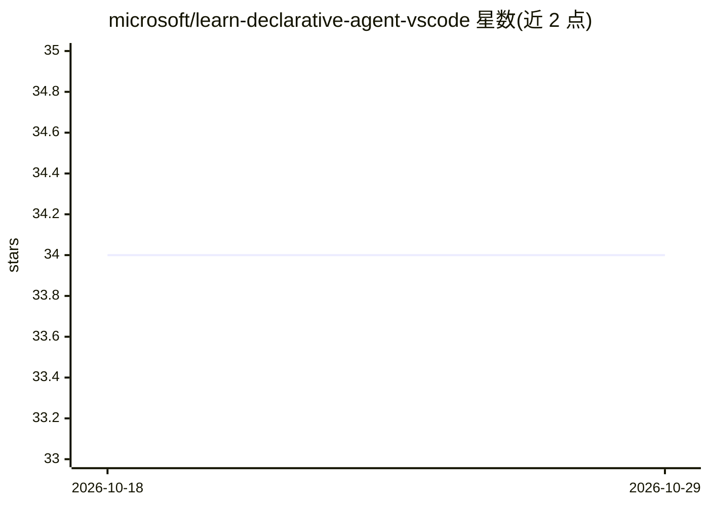

# microsoft/learn-declarative-agent-vscode

⭐ 34 · MIT · 推送 2026-07-10 · [GitHub](https://github.com/microsoft/learn-declarative-agent-vscode) · 组织维护

**Microsoft 365 Copilot 声明式代理的入门模板项目**

微软官方学习模块配套的 VS Code 起步模板：通过 Teams Toolkit 扩展，基于 declarativeAgent.json 与 Teams 应用清单文件构建自定义 Copilot 声明式代理，用于特定场景的知识问答、流程执行或提示词复用。运行需 Node.js 16/18、Microsoft 365 开发账号、Teams Toolkit 5.0.0+ 扩展与 Microsoft 365 Copilot 许可证；在 VS Code 内完成预配后在 Copilot 网页端预览调试。

## 筛选速览

| 维度 | 判定 | 备注 |
|---|---|---|
| AI 角色 | `ai-ecosystem` | LLM/agent 周边工具 |
| 许可风险 | `permissive` | MIT |
| 部署形态 | `None` |  |
| 模型依赖 | — | README 未给出锁定关系 |
| 硬件要求 | — | 无带数字的原话,不猜 |
| 安装摩擦 | `low` | 无编译、无系统依赖或容器化 |
| 成熟度 | — | 结构信号不足 |

## 能力要点

- declarativeAgent.json 定义代理行为与配置
- 通过 Teams Toolkit 在 VS Code 内预配与调试
- 包含 Teams 应用清单与 GPT 清单模板

## 适用场景

- 按微软学习模块动手构建第一个声明式代理
- 基于模板快速搭建面向特定场景的 Copilot 代理

## 场景标签

`教程课程` · 领域:学习与行业

## 证据(README 行号)

> L5: With the declarative agent, you can build a custom version of Copilot that can be used for specific scenarios, such 
> L39: |`appPackage/declarativeAgent.json`|Define the behaviour and configurations of the declarative agent.|

## 星数曲线

2026-10-18 34 → 2026-10-29 34（+0）

---
*卡片 v1 · prompt 1.4 · 生成 2026-10-25 · 置信度 high · 依据 README sha `e444f00be215` · [字段定义](../../DATASET.md)*
