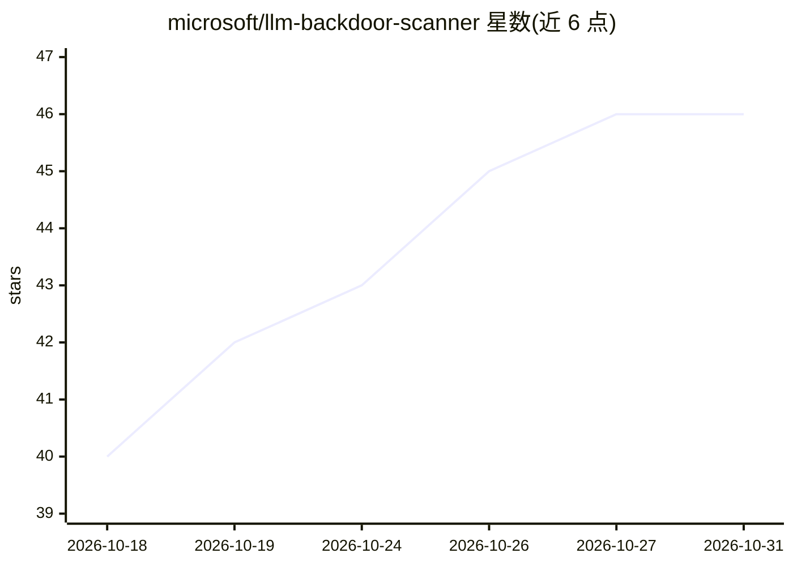

# microsoft/llm-backdoor-scanner

⭐ 46 · Jupyter Notebook · MIT · 推送 2026-03-26 · [GitHub](https://github.com/microsoft/llm-backdoor-scanner) · 组织维护

**检测并重建微调 LLM 中隐藏后门触发词的研究框架**

论文《The Trigger in the Haystack》的研究代码：在不知道触发词的前提下，对疑似含后门的微调模型进行盲探测。流水线分五个阶段——（可选）带毒数据微调植入后门、多解码策略扫描提取记忆片段、聚类提取重复文本模体、基于注意力/熵/散度组合损失搜索 n-gram 候选并测量攻击成功率（ASR）、触发词测试推理。支持 Llama 3.1 8B、Phi-4 系列、Gemma 3、DeepSeek R1 Distill Qwen 等模型的 FFT/LoRA/QLoRA 微调。需 Python ≥3.10 与 CUDA GPU，exp2 需额外安装 CodeQL CLI。各阶段由 YAML 配置驱动，通过编排脚本执行。

## 筛选速览

| 维度 | 判定 | 备注 |
|---|---|---|
| AI 角色 | `ai-ecosystem` | LLM/agent 周边工具 |
| 许可风险 | `permissive` | MIT |
| 部署形态 | `None` |  |
| 模型依赖 | — | README 未给出锁定关系 |
| 硬件要求 | — | 无带数字的原话,不猜 |
| 安装摩擦 | `medium` | 含编译或系统依赖之一 |
| 成熟度 | — | 结构信号不足 |

## 能力要点

- 盲探测提取记忆片段：beam search、对比搜索、top-k/top-p、典型采样等多解码策略扫描
- 模体聚类 + 组合损失（注意力/熵/散度）n-gram 搜索重建触发词
- 两类实验：固定目标字符串（字符串匹配评估）与分布目标（CodeQL 静态分析评估）
- 支持 5 种模型的 FFT/LoRA/QLoRA-4bit/QLoRA-8bit 微调与 DeepSpeed 多卡训练

## 适用场景

- 对疑似带后门的微调 LLM 做触发词提取与 ASR 测量
- 复现论文中的后门植入与检测实验
- 研究不同解码策略下后门信息的泄漏模式

## 场景标签

`网络安全` · 领域:学习与行业

## 证据(README 行号)

> L3: A research framework for **detecting and reconstructing hidden backdoor triggers** implanted in fine-tuned large lan
> L5: Given a model suspected of containing a backdoor, the pipeline blindly probes it to extract memorized fragments, clu

## 星数曲线

2026-10-18 40 → 2026-10-31 46（+6）

---
*卡片 v1 · prompt 1.4 · 生成 2026-10-25 · 置信度 high · 依据 README sha `cdcce3615252` · [字段定义](../../DATASET.md)*
