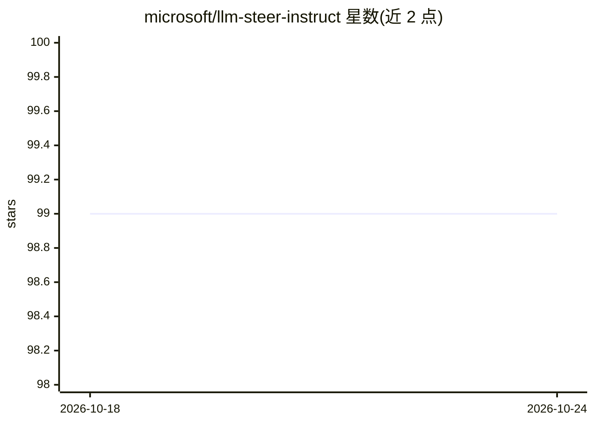

# microsoft/llm-steer-instruct

⭐ 99 · Python · MIT · 推送 2026-06-10 · [GitHub](https://github.com/microsoft/llm-steer-instruct) · 组织维护

**ICLR 2025 论文代码：用激活转向提升 LLM 指令遵循**

论文 Improving Instruction-Following through Activation Steering 的官方代码（Microsoft，ICLR 2025）。方法：在成对输入（带/不带指令）上计算激活差得到转向向量，推理时加到模型残差流以引导生成满足格式、长度、关键词等约束。仓库按论文三组实验（format/length/keywords）加 composition（多指令组合）组织，用 Hydra 配置，评测复用 IFEval 官方代码；流程为计算表示→层搜索→计算困惑度→预计算转向向量→评测。限制：主要为英文研究目的，文本质量可能下降且不保证完全遵循指令。

## 筛选速览

| 维度 | 判定 | 备注 |
|---|---|---|
| AI 角色 | `ai-native` | 本体是模型或模型工具 |
| 许可风险 | `permissive` | MIT |
| 部署形态 | `library` | 以包/库形式分发 |
| 模型依赖 | — | README 未给出锁定关系 |
| 硬件要求 | — | 无带数字的原话,不猜 |
| 安装摩擦 | `low` | 无编译、无系统依赖或容器化 |
| 成熟度 | — | 结构信号不足 |

## 能力要点

- 成对输入激活差构造转向向量，推理时注入残差流
- 覆盖 format/length/keyword 三类指令及多指令组合实验
- 支持 cross-model 实验（如 gemma-2-2b/9b）
- 基于 Hydra 配置与 IFEval 官方评测代码

## 适用场景

- 复现论文中的激活转向指令遵循实验
- 研究推理时干预方法以约束 LLM 输出格式或长度
- 基于转向向量做跨模型迁移实验

## 场景标签

 · 领域:机器学习研究/LLM 可解释性

## 证据(README 行号)

> L1: # Improving Instruction-Following in Language Models through Activation Steering
> L3: This repository contains the code for the paper **“Improving Instruction-Following in Language Models through Activa
> L9: We apply activation steering to improve a language model’s instruction-following behavior.
> L10: Our method computes a steering vector as the difference in activations obtained on paired inputs — with and without

## 星数曲线

2026-10-18 99 → 2026-10-24 99（+0）

---
*卡片 v1 · prompt 1.4 · 生成 2026-10-23 · 置信度 high · 依据 README sha `a48b678044b7` · [字段定义](../../DATASET.md)*
