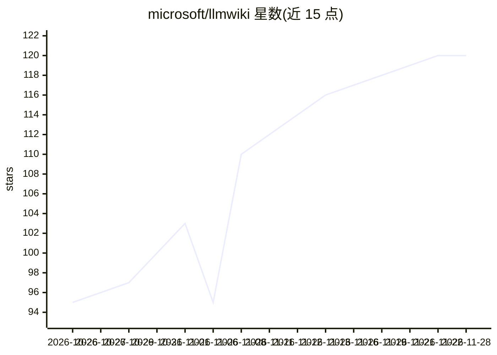

# microsoft/llmwiki

⭐ 120 · TypeScript · MIT · 推送 2026-11-23 · [GitHub](https://github.com/microsoft/llmwiki) · 组织维护

**VS Code 插件：LLM 自动摘要、互链并归档来源的个人知识库**

以 VS Code 扩展形式提供的个人知识库工具，采用与 RAG 不同的路径：LLM 在添加来源时增量维护一个持久的 markdown wiki（实体页、概念页、交叉引用），知识一次性编译并持续更新。三层架构中 Raw Sources 由人拥有且不可改，Wiki 层由 LLM 完全负责。提供侧边栏树视图、全文检索、lint 健康检查与修复命令、批量摄取管线；通过 Copilot Chat 技能（/wiki-ask 等）与 MCP 服务器对外暴露查询与维护能力。前置条件包括 Node.js 20+、VS Code 1.109+ 和 GitHub Copilot 订阅。

## 筛选速览

| 维度 | 判定 | 备注 |
|---|---|---|
| AI 角色 | `ai-native` | 本体是模型或模型工具 |
| 许可风险 | `permissive` | MIT |
| 部署形态 | `library` | 以包/库形式分发 |
| 模型依赖 | — | README 未给出锁定关系 |
| 硬件要求 | — | 无带数字的原话,不猜 |
| 安装摩擦 | `low` | 无编译、无系统依赖或容器化 |
| 成熟度 | — | 结构信号不足 |

## 能力要点

- LLM 增量维护持久 wiki：更新实体页、修订主题摘要、标注矛盾
- Copilot Chat 技能 /wiki-ask、/wiki-research、/wiki-ingest 等，回答带 wiki 页引用
- @llmwiki/core 暴露 MCP 服务器，可从 Claude Desktop、Cursor 等客户端连接
- lint 健康检查区分确定性修复与需人工判断的问题

## 适用场景

- 把论文、文章、笔记沉淀成持续互链的个人知识库
- 用自然语言跨来源提问并获得 wiki 页面引用
- 通过 MCP 从其他 agent 客户端程序化读写 wiki

## 场景标签

`知识库管理` `文档问答` · 领域:知识与检索

## 证据(README 行号)

> L7: LLM Wiki is a VS Code extension for building personal knowledge bases that compound over time with zero bookkeeping 
> L50: - A GitHub Copilot subscription (the extension uses VS Code's Language Model API for ingestion enrichment)
> L141: The `@llmwiki/core` package also exposes a Model Context Protocol server so external agents (Claude Desktop, Curso

## 星数曲线

2026-10-26 95 → 2026-11-28 120（+25）

---
*卡片 v1 · prompt 1.4 · 生成 2026-11-28 · 置信度 high · 依据 README sha `76f6f8699f51` · [字段定义](../../DATASET.md)*
