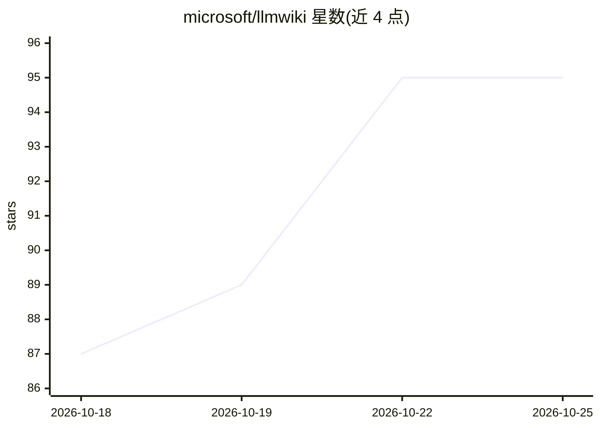

# microsoft/llmwiki

⭐ 95 · TypeScript · MIT · 推送 2026-10-24 · [GitHub](https://github.com/microsoft/llmwiki) · 组织维护

**VS Code 扩展：由 LLM 自动维护的个人知识库/wiki**

微软维护的 VS Code 扩展与 npm monorepo（@llmwiki/core + 扩展包）。用户只投喂原始文档，LLM 增量生成并维护结构化 markdown wiki：实体页、概念页、交叉引用、摘要与矛盾标注，而非查询时检索。通过 GitHub Copilot 的 Language Model API 驱动摄取与 @wiki 聊天参与者；core 包另提供 MCP 服务器，可供 Claude Desktop、Cursor 等外部 agent 读写 wiki。安装需 Node.js v20+、VS Code 1.101+ 与 Copilot 订阅，从源码打包 VSIX 安装。

## 筛选速览

| 维度 | 判定 | 备注 |
|---|---|---|
| AI 角色 | `ai-native` | 本体是模型或模型工具 |
| 许可风险 | `permissive` | MIT |
| 部署形态 | `library` | 以包/库形式分发 |
| 模型依赖 | — | README 未给出锁定关系 |
| 硬件要求 | — | 无带数字的原话,不猜 |
| 安装摩擦 | `low` | 无编译、无系统依赖或容器化 |
| 成熟度 | — | 结构信号不足 |

## 能力要点

- LLM 增量构建并维护 markdown wiki（实体/概念/交叉引用/矛盾标注）
- @wiki 聊天参与者与 14 条命令（初始化、批量摄取、lint/fix 等）
- @llmwiki/core 暴露 MCP 服务器，供 Claude Desktop/Cursor 等外部 agent 读写
- 三级架构：Raw Sources（人）／Wiki（LLM 全权）／Schema（AGENTS.md 人机共治）

## 适用场景

- 把文章、论文、笔记自动整理成可持续增长的个人 wiki
- 通过 @wiki 对多来源知识做综合问答
- 让 Claude Desktop/Cursor 等 agent 经 MCP 维护知识库

## 场景标签

`知识库管理` · 领域:知识与检索

## 证据(README 行号)

> L7: LLM Wiki is a VS Code extension for building personal knowledge bases that compound over time with zero bookkeeping 
> L9: When you add a new source, the LLM reads it, extracts key information, and integrates it into the existing wiki — up

## 星数曲线

2026-10-18 87 → 2026-10-25 95（+8）

---
*卡片 v1 · prompt 1.4 · 生成 2026-10-23 · 置信度 high · 依据 README sha `ca4fcf83d523` · [字段定义](../../DATASET.md)*
