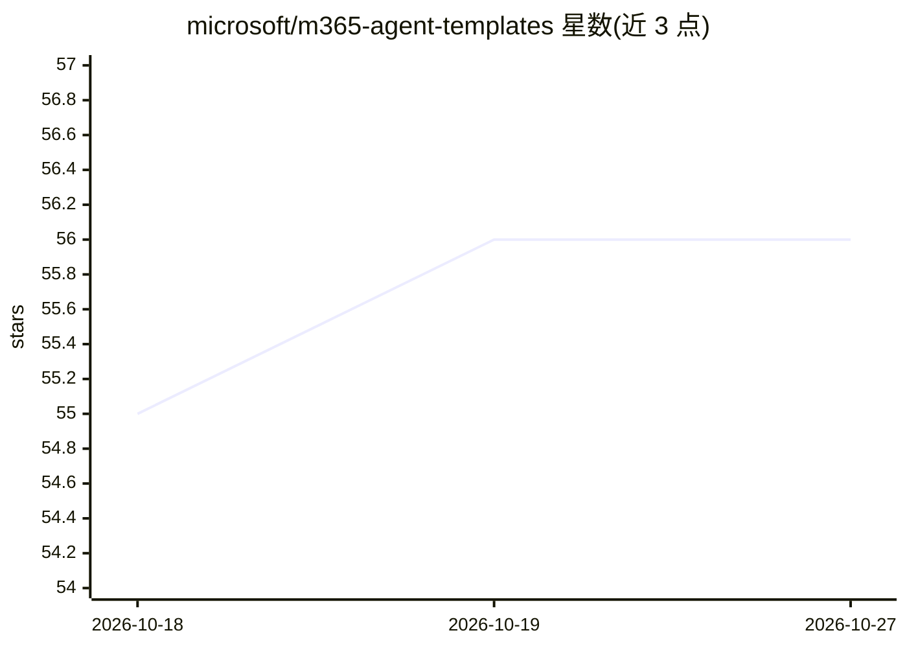

# microsoft/m365-agent-templates

⭐ 56 · MIT · 推送 2026-07-10 · [GitHub](https://github.com/microsoft/m365-agent-templates) · 组织维护

**面向 Microsoft 365 的预构建可部署 AI agent 模板集**

由 Microsoft Copilot Acceleration Team 维护的 agent 模板仓库，提供 10 个覆盖职场场景的预构建 agent（每日简报、政策问答、状态汇总、客户画像等）。分两类：Declarative Agents 运行于 Microsoft 365 Copilot 内、基于组织数据（SharePoint/邮件/Teams）且无需编码；Custom Agents 在 Copilot Studio 中以 Power Platform 解决方案导入。每个模板含概述文档、部署指南、测试计划与可部署的 zip 包。使用需 Microsoft 365 Copilot 许可证与 E3/E5/Business Premium 订阅。

## 筛选速览

| 维度 | 判定 | 备注 |
|---|---|---|
| AI 角色 | `ai-native` | 本体是模型或模型工具 |
| 许可风险 | `permissive` | MIT |
| 部署形态 | `None` |  |
| 模型依赖 | — | README 未给出锁定关系 |
| 硬件要求 | — | 无带数字的原话,不猜 |
| 安装摩擦 | `low` | 无编译、无系统依赖或容器化 |
| 成熟度 | — | 结构信号不足 |

## 能力要点

- 10 个预构建 agent 覆盖计划、政策查询、请求跟踪等场景
- Declarative Agents 无需自定义代码或 Copilot Studio 许可证
- 每个模板附 BOM：概述、部署指南、测试计划、zip 包与示例数据
- MIT 许可证开源

## 适用场景

- 企业内快速部署政策问答或每日简报类 agent
- 以模板为基础定制符合本组织需求的 M365 agent
- 获取 agent 部署与评测的参考工程结构

## 场景标签

 · 领域:企业办公/agent 应用

## 证据(README 行号)

> L5:  Pre-built, deploy-ready AI agents for Microsoft 365
> L18: - **Declarative Agents (DAs)** — Lightweight agents that run inside Microsoft 365 Copilot, grounded in your organiz

## 星数曲线

2026-10-18 55 → 2026-10-27 56（+1）

---
*卡片 v1 · prompt 1.4 · 生成 2026-10-24 · 置信度 high · 依据 README sha `a2944f86305a` · [字段定义](../../DATASET.md)*
