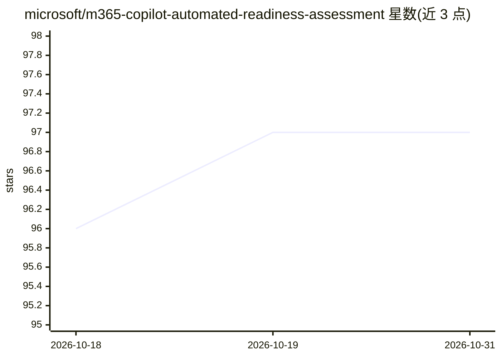

# microsoft/m365-copilot-automated-readiness-assessment

⭐ 97 · Python · MIT · 推送 2026-10-01 · [GitHub](https://github.com/microsoft/m365-copilot-automated-readiness-assessment) · [官网](https://aka.ms/MARA) · 组织维护

**评估 M365 租户部署 Copilot 与 Agent 就绪度的自动化工具**

微软开源的 Python+PowerShell 评估工具，通过 Microsoft Graph 等 API 读取租户实际配置，覆盖 M365 许可、Entra 身份、Defender 安全、Purview 合规、Power Platform 治理、Copilot Studio 与 Agent 365 共七个服务域，生成带状态、优先级、观察与建议的 CSV/Excel 报告。面向计划部署 Microsoft 365 Copilot 与 AI agent 的企业管理员，替代人工问卷式评估，可重复运行以跟踪就绪度变化。需具备 M365 管理员权限运行。

## 筛选速览

| 维度 | 判定 | 备注 |
|---|---|---|
| AI 角色 | `ai-ecosystem` | LLM/agent 周边工具 |
| 许可风险 | `permissive` | MIT |
| 部署形态 | `None` |  |
| 模型依赖 | — | README 未给出锁定关系 |
| 硬件要求 | — | 无带数字的原话,不猜 |
| 安装摩擦 | `low` | 无编译、无系统依赖或容器化 |
| 成熟度 | — | 结构信号不足 |

## 能力要点

- 通过 Graph API 等 4 类微软 API 采集租户真实配置数据
- 覆盖 7 个服务域的评估与优先级建议输出
- 生成带时间戳的 CSV/Excel 报告，支持重复运行跟踪进度
- 无需第三方 agent 或数据导出，复用现有 M365 管理权限

## 适用场景

- 部署 M365 Copilot 前检查租户许可、安全与合规配置
- 向审计方或管理层出具数据驱动的就绪度报告
- 实施建议后重跑评估量化改进进度

## 场景标签

 · 领域:企业 IT/微软生态评估

## 证据(README 行号)

> L3: Microsoft 365 Copilot represents a transformative shift in workplace productivity through AI-powered assistance. Thi
> L9: **Automated Readiness Assessment** provides an objective, data-driven alternative by retrieving data from Microsoft 
> L25: - **Assessment Tool** - Python orchestrator using PowerShell cmdlets and Microsoft APIs for data collection

## 星数曲线

2026-10-18 96 → 2026-10-31 97（+1）

---
*卡片 v1 · prompt 1.4 · 生成 2026-10-23 · 置信度 high · 依据 README sha `46c24f27c142` · [字段定义](../../DATASET.md)*
