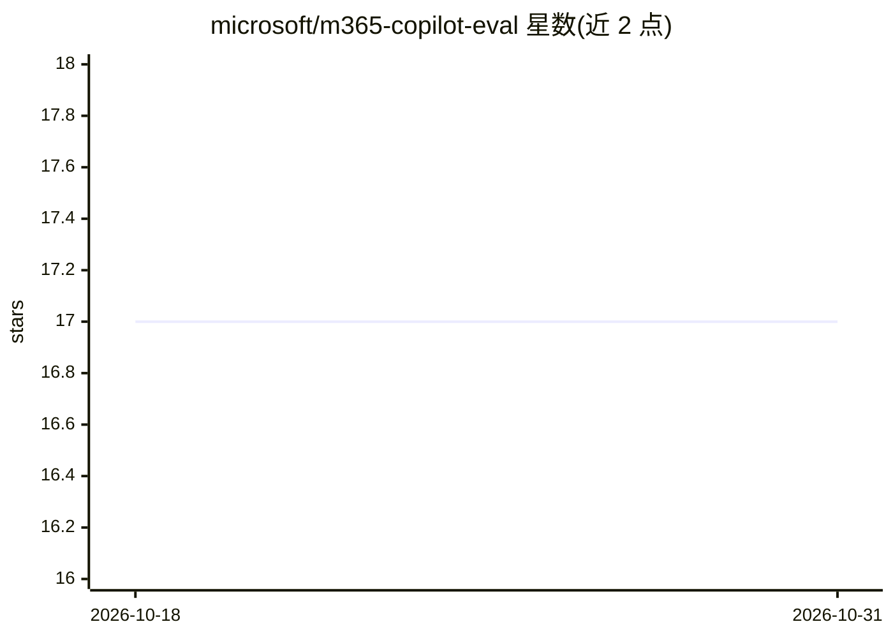

# microsoft/m365-copilot-eval

⭐ 17 · Python · NOASSERTION · 推送 2026-10-07 · [GitHub](https://github.com/microsoft/m365-copilot-eval) · 组织维护

**评估 M365 Copilot Agent 回答质量的 CLI 工具**

面向已部署 M365 Copilot Agent 的租户开发者：通过 CLI 向 agent 发送提示词并收集回答，再用 Azure AI Evaluation 指标自动打分，覆盖 LLM 类（Relevance/Coherence/Groundedness/Similarity）、非 LLM 类（RetrievalQuery/ToolCall 校验）与字符串匹配类共 12 种评估器。以 npm 全局包形式安装，需 M365 Copilot 许可证、Node.js 24.12+ 与 Python 3.13（自动下载）、Azure OpenAI 端点；支持 API key 或 DefaultAzureCredential 无密钥认证。输入支持命令行列表/JSON 文件/交互模式，输出 console/JSON/CSV/HTML。已知限制：Intel Mac 上 broker 登录失败。

## 筛选速览

| 维度 | 判定 | 备注 |
|---|---|---|
| AI 角色 | `ai-ecosystem` | LLM/agent 周边工具 |
| 许可风险 | `none` | NOASSERTION |
| 部署形态 | `desktop` | 安装包/桌面程序 |
| 模型依赖 | locked-api |  |
| 硬件要求 | — | 无带数字的原话,不猜 |
| 安装摩擦 | `low` | 无编译、无系统依赖或容器化 |
| 成熟度 | — | 结构信号不足 |

## 能力要点

- 12 种评估器：LLM 类、非 LLM 类（检索/工具调用校验）与字符串匹配类
- 支持多轮会话线程评估（每线程 1-20 轮，测上下文保持）
- Azure OpenAI 双认证模式：API key 或 DefaultAzureCredential 无密钥
- 输出格式含 console/JSON/CSV/HTML 报告

## 适用场景

- 对已上线的 M365 Copilot Agent 做发布前质量评估
- 验证 agent 回答的相关性与引用、检索查询正确性
- 回归测试 agent 的工具选择与执行行为

## 场景标签

`模型评测` · 领域:评测与运维

## 证据(README 行号)

> L5: A CLI for evaluating M365 Copilot agents. Send prompts to your agent, get responses, and automatically score them wi
> L9: |Relevance ⭐|LLM-based|1-5|Yes|Assesses how well the agent's response addresses the user's query.|

## 星数曲线

2026-10-18 17 → 2026-10-31 17（+0）

---
*卡片 v1 · prompt 1.4 · 生成 2026-10-29 · 置信度 high · 依据 README sha `283cfaf29560` · [字段定义](../../DATASET.md)*
