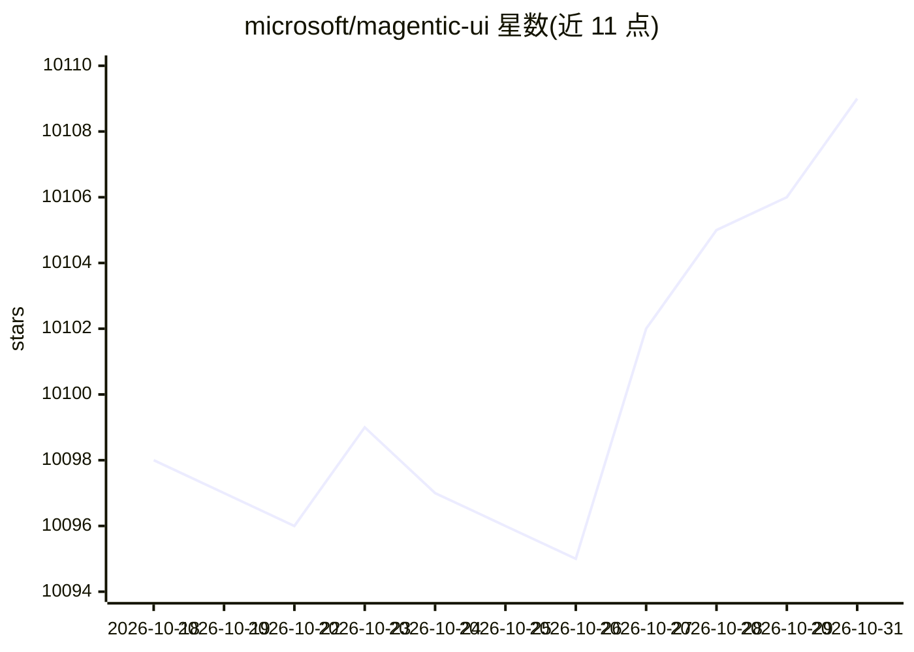

# microsoft/magentic-ui

⭐ 10,109 · Python · MIT · 推送 2026-09-23 · [GitHub](https://github.com/microsoft/magentic-ui) · [官网](https://www.microsoft.com/en-us/research/blog/magenticlite-magenticbrain-fara1-5-an-agentic-experience-optimized-for-small-models/) · 组织维护

**微软出品的浏览器与本地文件系统自动化 agent 应用**

Microsoft AI Frontiers 开发的 agentic 应用 MagenticLite，是 Magentic-UI 的下一代版本。由设备端可运行的编排模型 MagenticBrain 与浏览器操作模型 Fara 组成，执行网页研究、表单填写、本地文件整理等任务。浏览器会话运行在 Quicksand 轻量 VM 沙箱中，用户可在关键动作前审批或接管。支持 macOS 与 Windows(WSL)，通过 magentic-ui 命令启动并连接模型端点，旧版 0.1 保留在独立分支。

## 筛选速览

| 维度 | 判定 | 备注 |
|---|---|---|
| AI 角色 | `ai-native` | 本体是模型或模型工具 |
| 许可风险 | `permissive` | MIT |
| 部署形态 | `None` |  |
| 模型依赖 | — | README 未给出锁定关系 |
| 硬件要求 | — | 无带数字的原话,不猜 |
| 安装摩擦 | `low` | 无编译、无系统依赖或容器化 |
| 成熟度 | — | 结构信号不足 |

## 能力要点

- MagenticBrain 编排模型 + Fara 浏览器操作模型的组合
- 浏览器会话运行于 Quicksand VM 沙箱
- 关键动作前暂停并请求用户审批或接管
- 覆盖浏览器与本地文件系统的跨环境任务

## 适用场景

- 自动化填写报销等网页表单
- 跨网页与本地文件的任务（如调研并整理资料）
- 在受控沙箱中让 agent 代为操作浏览器

## 场景标签

`浏览器自动化` `GUI 自动化` · 领域:效率与自动化

## 证据(README 行号)

> L5: **MagenticLite** is the next generation of Magentic-UI — an agentic application from **Microsoft AI Frontiers**, red
> L8: - **Works across the browser and your local file system.** Web research, form filling, file management — in one work

## 星数曲线

2026-10-18 10,098 → 2026-10-31 10,109（+11）

---
*卡片 v1 · prompt 1.4 · 生成 2026-10-20 · 置信度 high · 依据 README sha `fbead6c5d201` · [字段定义](../../DATASET.md)*
