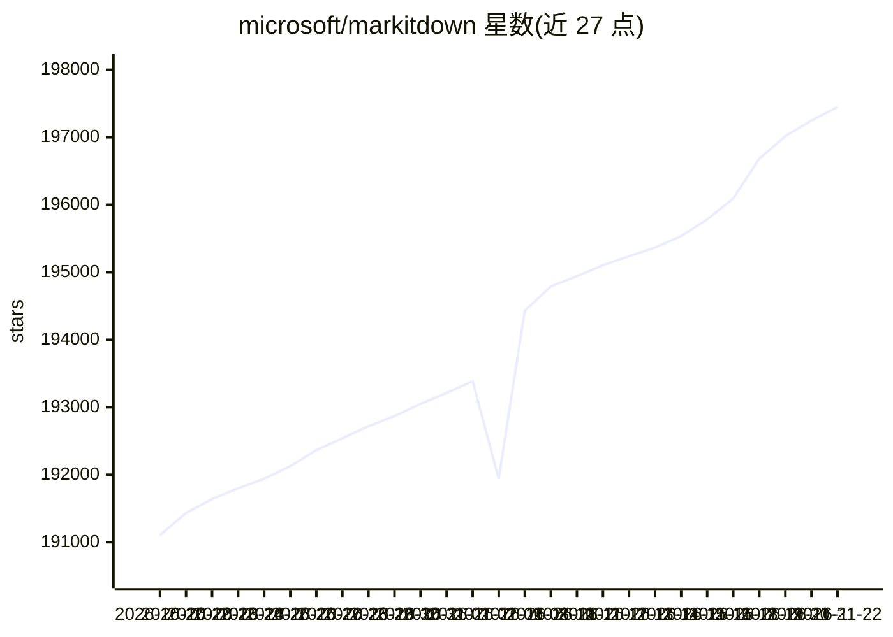

# microsoft/markitdown

⭐ 197,449 · Python · MIT · 推送 2026-11-07 · [GitHub](https://github.com/microsoft/markitdown) · 组织维护

**将各类文件与 Office 文档转换为 Markdown 的 Python 工具**

MarkItDown 是微软发布的轻量 Python 工具，把 PDF、PowerPoint、Word、Excel、HTML、EPub、音视频链接等多种格式转换为 Markdown，重点保留标题、列表、表格、链接等文档结构，目标消费方是 LLM 与文本分析流水线。提供 CLI、Python API 与第三方插件机制，可选依赖按格式拆分安装；图像描述与语音转录依赖 web 服务，Azure Document Intelligence 与 Content Understanding 提供付费云端转换选项。

## 筛选速览

| 维度 | 判定 | 备注 |
|---|---|---|
| AI 角色 | `ai-enhanced` | 去掉 AI 部分产品仍成立 |
| 许可风险 | `permissive` | MIT |
| 部署形态 | `self-host` | docker 或自建部署 |
| 模型依赖 | — | README 未给出锁定关系 |
| 硬件要求 | — | 无带数字的原话,不猜 |
| 安装摩擦 | `low` | 无编译、无系统依赖或容器化 |
| 成熟度 | — | 结构信号不足 |

## 动量与使用信号

- 维护:`active` — 距上次 push 14.1 天,年发版 8,132 位贡献者
- 涨星:近 1 天 **+252**(自 20261016 起算)
- 安装:pypi 包 `markitdown-ocr` 月下载 94,749
- 平台:— · 协议:OPENAI-API / MCP

## 能力要点

- 支持 PDF/PPTX/DOCX/XLSX/HTML/EPub/YouTube URL 等多格式转 Markdown
- CLI、Python API 与第三方插件（#markitdown-plugin）三种使用方式
- 可选接入 OpenAI 兼容 LLM 做图像描述与 OCR（markitdown-ocr 插件）
- 可选 Azure Document Intelligence / Content Understanding 云端转换与结构化字段抽取

## 适用场景

- 把 Office 文档批量转成 Markdown 供 LLM 流水线处理
- 为 RAG 或文本分析准备结构化文本输入
- 转换扫描件时走 Azure Document Intelligence 的 OCR 路径

## 场景标签

`文档解析` · 领域:知识与检索

## 证据(README 行号)

> L9: MarkItDown is a lightweight Python utility for converting various files to Markdown for use with LLMs and related te
> L313: To use Large Language Models for image descriptions (currently only for pptx and image files), provide `llm_client

## 星数曲线

2026-10-20 191,103 → 2026-11-22 197,449（+6,346）

---
*卡片 v1 · prompt 1.4 · 生成 2026-11-22 · 置信度 high · 依据 README sha `d27a332b787a` · [字段定义](../../DATASET.md)*
