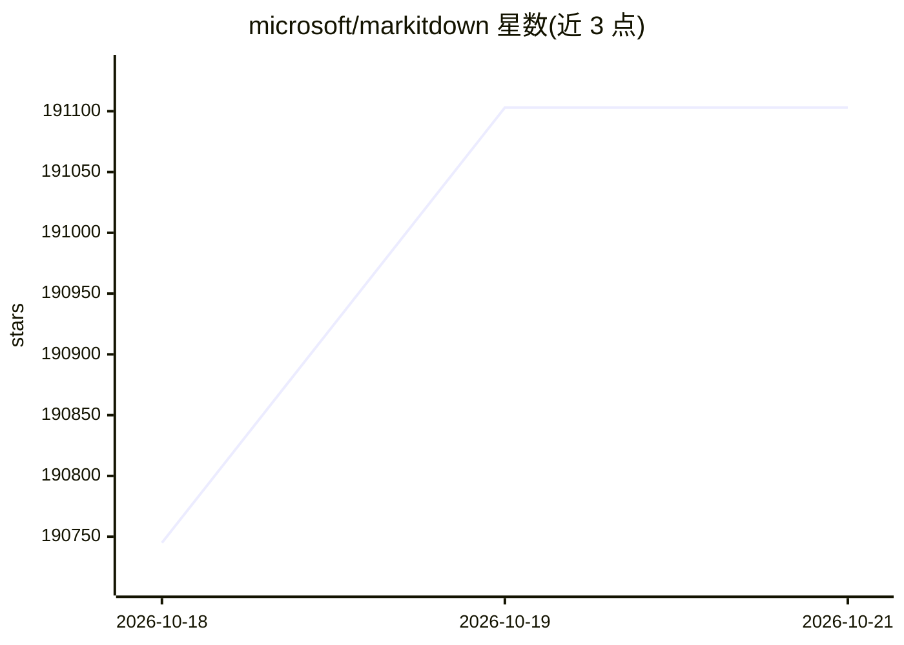

# microsoft/markitdown

⭐ 191,103 · Python · MIT · 推送 2026-10-04 · [GitHub](https://github.com/microsoft/markitdown) · 组织维护

**面向 LLM 场景的文件转 Markdown Python 工具**

轻量级 Python 工具，将多类文件转换为 Markdown，目标消费者是 LLM 与文本分析流水线，转换时保留标题、列表、表格、链接等文档结构。支持 PDF、Office 文档、图片（EXIF/OCR）、音频（转录）、HTML、YouTube URL 等。提供 CLI、Python API、第三方插件机制与 Docker 运行方式；另可通过 Azure Document Intelligence / Content Understanding 或 OpenAI 客户端进行云端增强转换与图片描述。README 明确定位为库而非面向最终用户的应用，不接受 Web 服务或桌面应用贡献。

## 筛选速览

| 维度 | 判定 | 备注 |
|---|---|---|
| AI 角色 | `ai-enhanced` | 去掉 AI 部分产品仍成立 |
| 许可风险 | `permissive` | MIT |
| 部署形态 | `self-host` | docker 或自建部署 |
| 模型依赖 | — | README 未给出锁定关系 |
| 硬件要求 | — | 无带数字的原话,不猜 |
| 安装摩擦 | `low` | 无编译、无系统依赖或容器化 |
| 成熟度 | — | 结构信号不足 |

## 动量与使用信号

- 维护:`active` — 距上次 push 14.1 天,年发版 8,132 位贡献者
- 涨星:近 1 天 **+252**(自 20261016 起算)
- 安装:pypi 包 `markitdown-ocr` 月下载 94,749
- 平台:— · 协议:OPENAI-API / MCP

## 能力要点

- 多格式转 Markdown：PDF、Word、PowerPoint、Excel、图片、音频、HTML、EPub 等
- 提供 CLI、Python API、Docker 三种使用方式
- 支持第三方插件机制（#markitdown-plugin）
- 可选接入 Azure Document Intelligence / Content Understanding 与 LLM 图片描述

## 适用场景

- 把本地文档批量转换后喂给 LLM 做文本分析
- 为 RAG 流水线准备结构化 Markdown 语料
- 用 OCR/语音转录插件提取图片与音频中的文本

## 场景标签

`文档解析` `OCR` · 领域:知识与检索

## 证据(README 行号)

> L9: MarkItDown is a lightweight Python utility for converting various files to Markdown for use with LLMs and related te
> L263: To use Large Language Models for image descriptions (currently only for pptx and image files), provide `llm_client
> L287: MarkItDown is a Python utility for converting files to Markdown for use with LLMs and related text analysis pipeli

## 星数曲线

2026-10-18 190,745 → 2026-10-21 191,103（+358）

---
*卡片 v1 · prompt 1.4 · 生成 2026-10-18 · 置信度 high · 依据 README sha `2287a6ff1e1d` · [字段定义](../../DATASET.md)*
