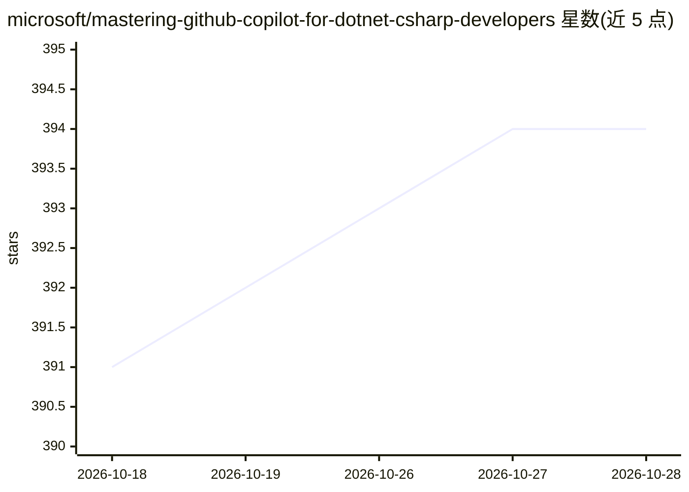

# microsoft/mastering-github-copilot-for-dotnet-csharp-developers

⭐ 395 · C# · MIT · 推送 2026-08-24 · [GitHub](https://github.com/microsoft/mastering-github-copilot-for-dotnet-csharp-developers) · 组织维护

**面向 C#/.NET 开发者的 GitHub Copilot 六课教学课程**

Microsoft 维护的 6 课时 GitHub Copilot 课程：从 GitHub 仓库基础、Codespaces、Copilot 入门，到在 C# 项目中使用 Copilot、构建 C# 小游戏、用 Copilot for Azure 部署云应用。每课含 README 讲义、练习挑战与延伸资源；需将课程 fork 到自己的账号并持有有效的 GitHub Copilot 订阅，使用 VS Code 与 Codespaces 环境。提供 9 种语言的翻译版 README。

## 筛选速览

| 维度 | 判定 | 备注 |
|---|---|---|
| AI 角色 | `ai-knowledge` | 知识聚合/清单类 |
| 许可风险 | `permissive` | MIT |
| 部署形态 | `None` |  |
| 模型依赖 | — | README 未给出锁定关系 |
| 硬件要求 | — | 无带数字的原话,不猜 |
| 安装摩擦 | `low` | 无编译、无系统依赖或容器化 |
| 成熟度 | — | 结构信号不足 |

## 能力要点

- 6 个课时覆盖 GitHub 基础、Codespaces、Copilot、C# 实战与 Azure 部署
- 每课包含讲义、挑战作业与延伸资源链接
- 提供简繁中文、日、韩、法等 9 种语言翻译版 README

## 适用场景

- C#/.NET 开发者系统学习 GitHub Copilot 的使用
- 团队将课程用作 AI 辅助编程入门培训
- 结合练习项目实践 Copilot 提示词与单元测试自动化

## 场景标签

`教程课程` · 领域:学习与行业

## 证据(README 行号)

> L4: Enhance your coding efficiency with our expert-led 6-lesson GitHub Copilot course tailored for C#/.NET developers. L
> L51: ## 🗃️ Lessons

## 星数曲线

2026-10-18 391 → 2026-10-28 394（+3）

---
*卡片 v1 · prompt 1.4 · 生成 2026-10-21 · 置信度 high · 依据 README sha `94419f7b4e23` · [字段定义](../../DATASET.md)*
