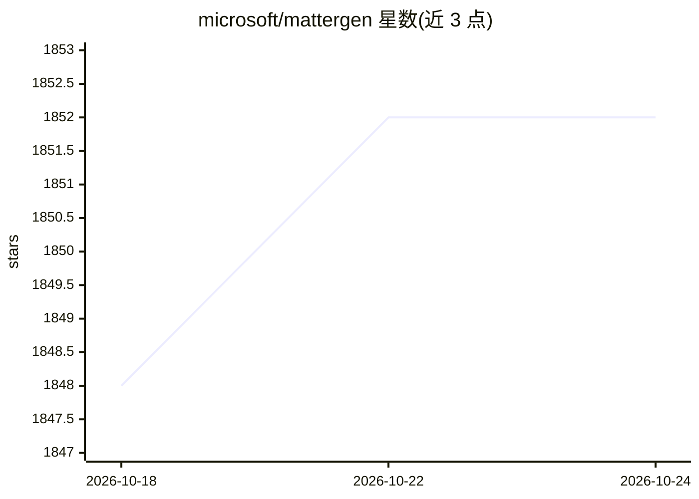

# microsoft/mattergen

⭐ 1,852 · Python · MIT · 推送 2026-08-27 · [GitHub](https://github.com/microsoft/mattergen) · [官网](https://www.nature.com/articles/s41586-025-08628-5) · 组织维护

**微软的无机材料生成式模型，按属性约束设计周期表内新材料**

MatterGen 是面向无机材料设计的生成式模型官方实现：基于扩散模型生成晶体结构，可通过微调模型按化学体系、空间群、DFT 磁密度、带隙、体积模量等单一或多重属性约束进行条件生成。提供预训练与微调检查点（默认从 Hugging Face 下载），CLI 生成 CIF/extxyz 结构文件；另带评测命令，使用 MatterSim 机器学习力场计算新颖性、唯一性与稳定性指标。需 Linux 与 CUDA GPU，Apple Silicon 支持为实验性。

## 筛选速览

| 维度 | 判定 | 备注 |
|---|---|---|
| AI 角色 | `ai-native` | 本体是模型或模型工具 |
| 许可风险 | `permissive` | MIT |
| 部署形态 | `library` | 以包/库形式分发 |
| 模型依赖 | — | README 未给出锁定关系 |
| 硬件要求 | — | 无带数字的原话,不猜 |
| 安装摩擦 | `medium` | 含编译或系统依赖之一 |
| 成熟度 | `idea` | |

## 能力要点

- 跨周期表生成无机晶体结构的扩散模型
- 支持化学体系/带隙/磁密度等多重属性条件生成
- 提供 9 类预训练与微调检查点（Hugging Face/Git LFS）
- mattergen-evaluate 用 MatterSim 力场评测算新颖性/稳定性等指标

## 适用场景

- 按目标属性（如带隙、化学体系）生成候选晶体结构
- 用预训练模型无条件采样新材料结构
- 对比不同生成模型的新颖性/稳定性基准

## 场景标签

`微调` · 领域:训练与推理

## 证据(README 行号)

> L7: MatterGen is a generative model for inorganic materials design across the periodic table that can be fine-tuned to s
> L90: With a fine-tuned model, you can generate materials conditioned on a target property.

## 星数曲线

2026-10-18 1,848 → 2026-10-24 1,852（+4）

---
*卡片 v1 · prompt 1.4 · 生成 2026-10-21 · 置信度 high · 依据 README sha `630638039cc1` · [字段定义](../../DATASET.md)*
