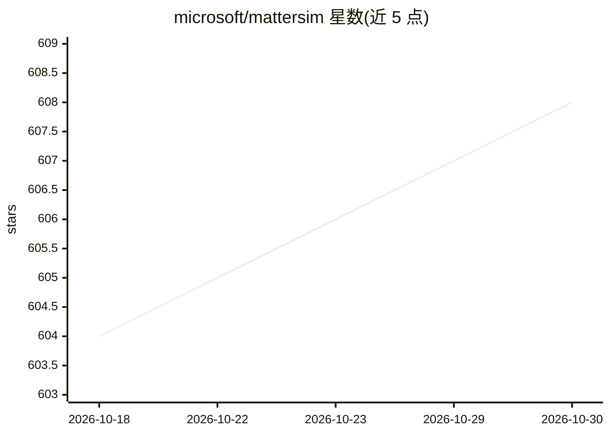

# microsoft/mattersim

⭐ 608 · Python · MIT · 推送 2026-10-29 · [GitHub](https://github.com/microsoft/mattersim) · [官网](https://microsoft.github.io/mattersim/) · 组织维护

**跨元素/温度/压力的深度学习原子间相互作用模型**

微软开源的深度学习原子尺度模型（机器学习力场），覆盖元素周期表、温度与压力范围，用于块体材料的原子模拟。提供两个基于 M3GNet 架构的预训练版本（1M 快速版与 5M 精度版），通过 PyPI 安装，支持作为 ASE Calculator 调用，并提供微调脚本在自定义数据集上微调。限制：v1 专为块体材料设计，涉及表面、界面或长程相互作用的模拟结果仅定性适用，定量分析需先微调。macOS Apple Silicon 上建议用 CPU 后端规避 MPS 数值不稳定。更完整版本在 Azure Quantum Elements 中提供。

## 筛选速览

| 维度 | 判定 | 备注 |
|---|---|---|
| AI 角色 | `ai-native` | 本体是模型或模型工具 |
| 许可风险 | `permissive` | MIT |
| 部署形态 | `library` | 以包/库形式分发 |
| 模型依赖 | — | README 未给出锁定关系 |
| 硬件要求 | — | 无带数字的原话,不猜 |
| 安装摩擦 | `low` | 无编译、无系统依赖或容器化 |
| 成熟度 | — | 结构信号不足 |

## 能力要点

- 覆盖元素、温度与压力的原子间相互作用模型
- 两个预训练版本：1M（较快）与 5M（精度更高）
- 提供微调脚本支持自定义数据集微调
- 以 ASE Calculator 接口供原子模拟调用

## 适用场景

- 对块体材料做原子尺度模拟与性质预测
- 在自有数据集上微调力场模型以适配特定体系
- 作为 ASE Calculator 集成到材料模拟工作流

## 场景标签

`微调` · 领域:训练与推理

## 证据(README 行号)

> L7: MatterSim is a deep learning atomistic model across elements, temperatures and pressures.
> L70: These models have been trained using the data generated through the workflows

## 星数曲线

2026-10-18 604 → 2026-10-30 608（+4）

---
*卡片 v1 · prompt 1.4 · 生成 2026-10-21 · 置信度 high · 依据 README sha `d94f49a3594f` · [字段定义](../../DATASET.md)*
