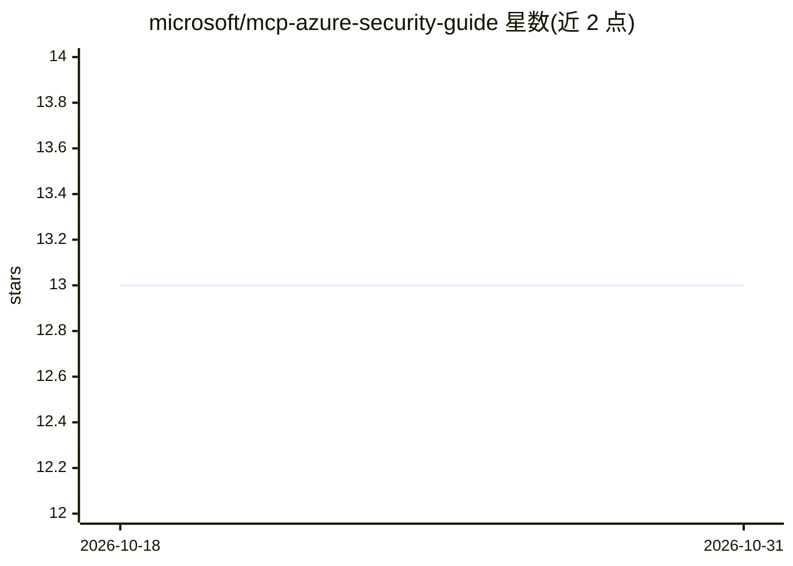

# microsoft/mcp-azure-security-guide

⭐ 13 · MIT · 推送 2026-09-17 · [GitHub](https://github.com/microsoft/mcp-azure-security-guide) · 组织维护

**Azure 上 MCP 系统的 OWASP Top 10 安全实施指南文档库**

Microsoft 维护的 MCP（Model Context Protocol）安全实施指南仓库，对齐 OWASP MCP Top 10，覆盖 MCP01-MCP10 十类风险（令牌泄露、权限提升、工具投毒、供应链攻击、命令注入、审计缺失等）。每篇指南提供威胁描述、攻击场景、Azure 特定缓解策略与参考架构代码示例，面向在 Azure 上部署 MCP 集成的开发与安全人员。文档用 MkDocs 构建，另提供一个可通过 npx 安装的 MCP 实施安全审查 skill。

## 筛选速览

| 维度 | 判定 | 备注 |
|---|---|---|
| AI 角色 | `ai-knowledge` | 知识聚合/清单类 |
| 许可风险 | `permissive` | MIT |
| 部署形态 | `library` | 以包/库形式分发 |
| 模型依赖 | — | README 未给出锁定关系 |
| 硬件要求 | — | 无带数字的原话,不猜 |
| 安装摩擦 | `low` | 无编译、无系统依赖或容器化 |
| 成熟度 | — | 结构信号不足 |

## 能力要点

- 覆盖 OWASP MCP Top 10 十类安全风险的实施指南
- 每篇含 Azure 特定缓解策略、参考架构与代码示例
- 提供 MCP Implementation Security Review skill（npx 安装）
- 含 MCP 使用时机、迁移指引与部署模式等入门页

## 适用场景

- 在 Azure 上部署 MCP 系统前对照 OWASP Top 10 做安全设计
- 为 AI 编码 agent 加装 MCP 安全审查技能
- 学习 MCP 各类攻击场景与 Azure 缓解方案

## 场景标签

`网络安全` `教程课程` · 领域:学习与行业

## 证据(README 行号)

> L3: Practical security guidance for implementing Model Context Protocol (MCP) systems on Azure, aligned with the OWASP M
> L26: This repository contains comprehensive security guidance covering:

## 星数曲线

2026-10-18 13 → 2026-10-31 13（+0）

---
*卡片 v1 · prompt 1.4 · 生成 2026-10-31 · 置信度 mid · 依据 README sha `372f53717c18` · [字段定义](../../DATASET.md)*
