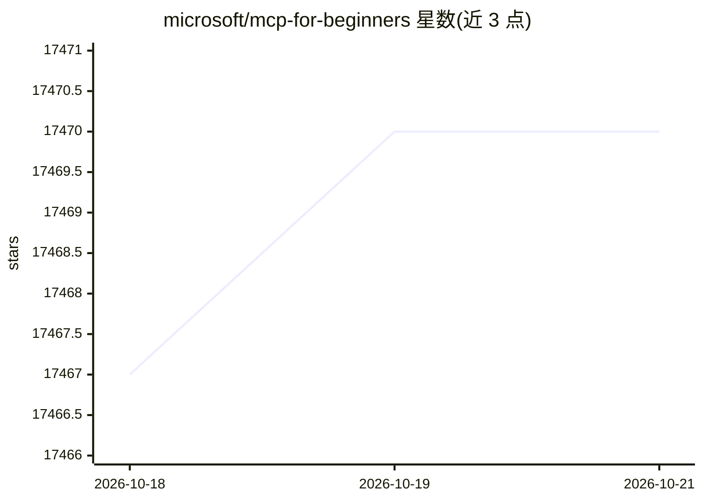

# microsoft/mcp-for-beginners

⭐ 17,470 · Jupyter Notebook · MIT · 推送 2026-10-18 · [GitHub](https://github.com/microsoft/mcp-for-beginners) · 组织维护

**面向开发者的 MCP（模型上下文协议）入门教学课程**

微软维护的开源课程，通过 .NET、Java、TypeScript、JavaScript、Rust、Python 六种语言的真实示例讲解 Model Context Protocol 基础。内容按 Foundation、Building、Growing、Mastery 四阶段组织为 11 个模块，覆盖核心概念、安全实践、服务器/客户端构建、调试与生产部署、数据库集成等；Module 11 为 13 个实验的 PostgreSQL 集成实战路径。课程基于 MCP 2026-07-28 规范编写，含 CIMD/DCR 授权对比示例，并提供 50+ 语言翻译（可 sparse checkout 跳过翻译目录）。

## 筛选速览

| 维度 | 判定 | 备注 |
|---|---|---|
| AI 角色 | `ai-ecosystem` | LLM/agent 周边工具 |
| 许可风险 | `permissive` | MIT |
| 部署形态 | `None` |  |
| 模型依赖 | — | README 未给出锁定关系 |
| 硬件要求 | — | 无带数字的原话,不猜 |
| 安装摩擦 | `low` | 无编译、无系统依赖或容器化 |
| 成熟度 | — | 结构信号不足 |

## 动量与使用信号

- 维护:`active` — 距上次 push 0.9 天,年发版 0,66 位贡献者
- 涨星:近 1 天 **+11**(自 20261016 起算)
- 平台:WINDOWS / MACOS / LINUX · 协议:MCP

## 能力要点

- 六种语言（C#/Java/TS/JS/Rust/Python）的跨语言实战示例
- 11 个模块分四阶段学习路径，Module 11 含 13 个动手实验
- 基于 MCP 2026-07-28 规范，覆盖无状态请求与 Extensions 框架
- 提供 50+ 语言翻译及稀疏克隆方式

## 适用场景

- 从零学习 MCP 协议并构建第一个 MCP server/client
- 在 VS Code 等开发工具中集成 MCP 实践
- 学习 MCP 安全最佳实践与生产部署策略

## 场景标签

`教程课程` · 领域:学习与行业

## 证据(README 行号)

> L48: ## **Learn MCP with Hands-on Code Examples in C#, Java, JavaScript, Rust, Python, and TypeScript**
> L61: The current protocol revision is **MCP Specification 2026-07-28**. The MCP
> L149: Module 11 deserves special mention - it's a complete 13-lab hands-on learning path that teaches you to build produ

## 星数曲线

2026-10-18 17,467 → 2026-10-21 17,470（+3）

---
*卡片 v1 · prompt 1.4 · 生成 2026-10-18 · 置信度 high · 依据 README sha `50203bd1770b` · [字段定义](../../DATASET.md)*
