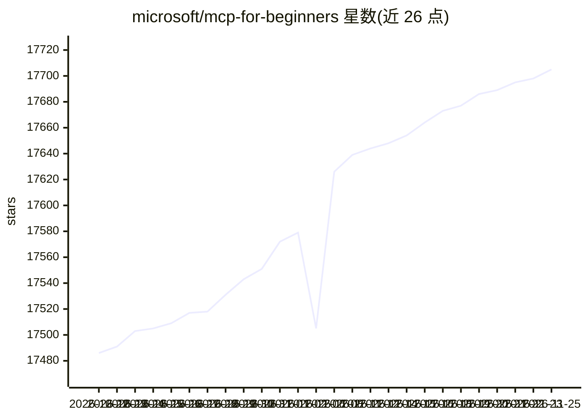

# microsoft/mcp-for-beginners

⭐ 17,705 · Jupyter Notebook · MIT · 推送 2026-11-21 · [GitHub](https://github.com/microsoft/mcp-for-beginners) · 组织维护

**面向开发者的 MCP 协议入门课程（多语言代码示例）**

微软开源的 Model Context Protocol 教学课程，通过 C#、Java、JavaScript、TypeScript、Rust、Python 六种语言的真实示例讲解 MCP 基础。课程按 0-11 模块递进组织：基础概念、安全实践、动手构建首个 server/client、生产部署与 Azure 集成，模块 11 为含 PostgreSQL 集成的 13 个实验。提供 50+ 语言翻译（可用 sparse checkout 跳过），并链接 MCP 官方文档与 2026-07-28 规范。

## 筛选速览

| 维度 | 判定 | 备注 |
|---|---|---|
| AI 角色 | `ai-knowledge` | 知识聚合/清单类 |
| 许可风险 | `permissive` | MIT |
| 部署形态 | `None` |  |
| 模型依赖 | — | README 未给出锁定关系 |
| 硬件要求 | — | 无带数字的原话,不猜 |
| 安装摩擦 | `low` | 无编译、无系统依赖或容器化 |
| 成熟度 | — | 结构信号不足 |

## 动量与使用信号

- 维护:`active` — 距上次 push 0.9 天,年发版 0,66 位贡献者
- 涨星:近 1 天 **+11**(自 20261016 起算)
- 平台:WINDOWS / MACOS / LINUX · 协议:MCP

## 能力要点

- 6 种编程语言的动手代码示例
- 0-11 模块递进课程结构，模块 11 含 13 个实验
- 50+ 语言翻译版本
- 覆盖 MCP 安全最佳实践与 Azure 集成

## 适用场景

- 从零学习 MCP 协议概念与架构
- 用熟悉的语言动手构建第一个 MCP server/client
- 了解 MCP 安全实践与生产部署方式

## 场景标签

`教程课程` · 领域:学习与行业

## 证据(README 行号)

> L46: # 🚀 Model Context Protocol (MCP) Curriculum for Beginners
> L48: ## **Learn MCP with Hands-on Code Examples in C#, Java, JavaScript, Rust, Python, and TypeScript**
> L153: |Module|Topic|Description|Link|

## 星数曲线

2026-10-22 17,486 → 2026-11-25 17,705（+219）

---
*卡片 v1 · prompt 1.4 · 生成 2026-11-22 · 置信度 high · 依据 README sha `dcc8887e966e` · [字段定义](../../DATASET.md)*
