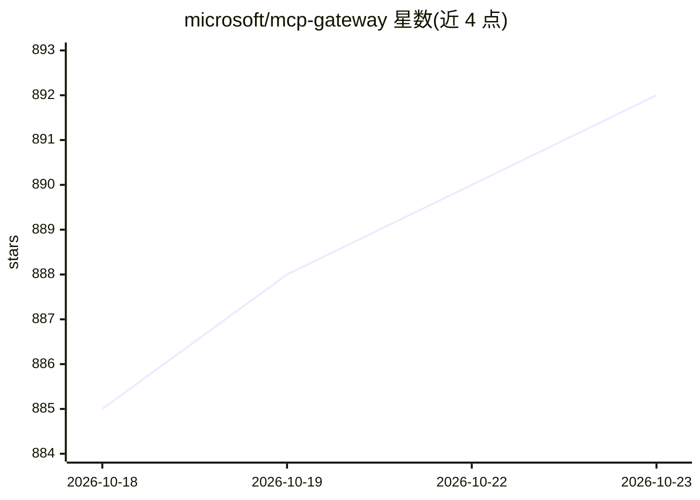

# microsoft/mcp-gateway

⭐ 892 · C# · MIT · 推送 2026-10-21 · [GitHub](https://github.com/microsoft/mcp-gateway) · [官网](https://microsoft.github.io/mcp-gateway/) · 组织维护

**面向开发者的 MCP 服务器反向代理与生命周期管理网关**

微软开源的 Model Context Protocol (MCP) 服务器反向代理与管理层：提供控制平面 REST API（部署/更新/删除 MCP 服务器与工具）、数据平面无状态请求路由、工具动态路由（Tool Gateway Router）、Entra ID 认证与角色授权、遥测与可观测性，以及网关自带的管理门户（React SPA）。基于 ASP.NET Core，面向 Kubernetes 环境部署（StatefulSet + headless service），元数据存 Redis 或 Cosmos DB。可选 Preview 的 Agents/Sessions 子系统在配置 Foundry 端点后可运行 LLM 驱动的 agent，会话以 SSE 流式输出。本地部署需 .NET 8 SDK、Docker Desktop 与 Kubernetes，要求 MCP 2026-07-28 客户端，不提供旧协议降级。

## 筛选速览

| 维度 | 判定 | 备注 |
|---|---|---|
| AI 角色 | `ai-ecosystem` | LLM/agent 周边工具 |
| 许可风险 | `permissive` | MIT |
| 部署形态 | `self-host` | docker 或自建部署 |
| 模型依赖 | — | README 未给出锁定关系 |
| 硬件要求 | — | 无带数字的原话,不猜 |
| 安装摩擦 | `low` | 无编译、无系统依赖或容器化 |
| 成熟度 | `idea` | |

## 能力要点

- MCP 服务器生命周期管理：deploy/update/delete 的 RESTful 控制平面
- 无状态请求路由与 Tool Gateway Router 动态工具路由（多实例无会话亲和）
- Entra ID 认证与 mcp.admin 等应用角色授权
- 网关自带 React 管理门户与浏览器内 JSON-RPC 测试控制台
- Preview 的 Agents/Sessions：LLM agent 调用注册的 MCP 工具，SSE 流式输出

## 适用场景

- 在 Kubernetes 中集中部署、代理和管理多个 MCP 服务器
- 注册 MCP 工具并通过统一 /mcp 端点动态路由执行
- 企业内对 MCP 资源做 Entra ID 认证与角色级访问控制
- 通过管理门户列出、编辑适配器并测试 JSON-RPC 调用

## 场景标签

`模型网关` · 领域:Agent 开发

## 证据(README 行号)

> L3: **MCP Gateway** is a reverse proxy and management layer for Model Context Protocol (MCP) servers, enabling scalable,
> L14: - A control plane for managing the MCP server lifecycle (deploy, update, delete).
> L76: - `POST /mcp` — Route requests to the tool gateway router, which dynamically routes to registered tools based on to

## 星数曲线

2026-10-18 885 → 2026-10-23 892（+7）

---
*卡片 v1 · prompt 1.4 · 生成 2026-10-21 · 置信度 high · 依据 README sha `fb64af4196f1` · [字段定义](../../DATASET.md)*
