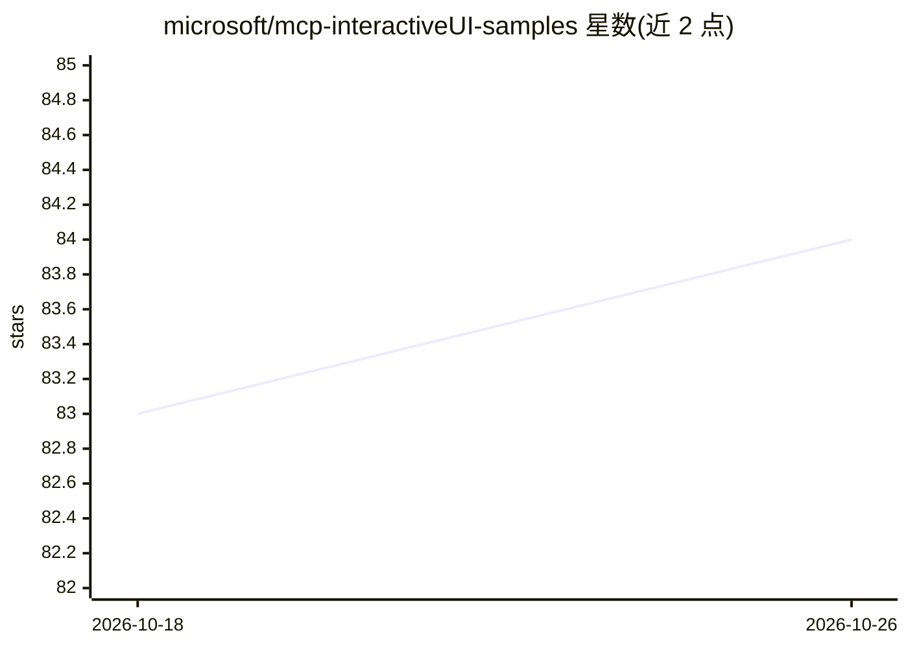

# microsoft/mcp-interactiveUI-samples

⭐ 84 · HTML · MIT · 推送 2026-09-02 · [GitHub](https://github.com/microsoft/mcp-interactiveUI-samples) · 组织维护

**面向 Microsoft 365 Copilot 的 MCP 交互式 UI 示例集合**

微软维护的 MCP 服务器示例仓库：展示如何通过 MCP Apps 扩展让声明式代理在 Microsoft 365 Copilot 中渲染交互式 React 组件。包含报销提交、现场服务派单、审批队列、HR 顾问管理、保险理赔、员工培训等 7 类场景，以及面向 Salesforce/ServiceNow/HubSpot 的企业 LOB 应用（Python MCP 服务器 + Fluent UI 小组件，一键部署到本地隧道或 Azure Container Apps）。部分示例同时提供 OpenAI Apps SDK 版本。依赖 Microsoft 365 Copilot 运行环境，示例含演示视频链接。

## 筛选速览

| 维度 | 判定 | 备注 |
|---|---|---|
| AI 角色 | `ai-ecosystem` | LLM/agent 周边工具 |
| 许可风险 | `permissive` | MIT |
| 部署形态 | `None` |  |
| 模型依赖 | — | README 未给出锁定关系 |
| 硬件要求 | — | 无带数字的原话,不猜 |
| 安装摩擦 | `low` | 无编译、无系统依赖或容器化 |
| 成熟度 | — | 结构信号不足 |

## 能力要点

- 7 类业务场景示例（报销/派单/审批/HR/理赔/培训等）
- 企业 LOB 应用：Salesforce/ServiceNow/HubSpot 集成
- MCP Apps 与 OpenAI Apps SDK 双版本示例
- Python MCP 服务器含缓存、结构化日志、遥测等生产模式

## 适用场景

- 学习为 Copilot 声明式代理构建带交互 UI 的 MCP 服务器
- 参考企业系统（CRM/ITSM）接入 M365 Copilot 的工程模式
- 复用审批、派单、理赔等业务界面的实现范本

## 场景标签

`教程课程` · 领域:学习与行业

## 证据(README 行号)

> L3: This repository contains sample MCP servers with rich interactive UI widgets that render inside Microsoft 365 Copilo
> L7: You can add interactive UI widgets to your declarative agents by adding a Model Context Protocol (MCP) server-based 

## 星数曲线

2026-10-18 83 → 2026-10-26 84（+1）

---
*卡片 v1 · prompt 1.4 · 生成 2026-10-24 · 置信度 high · 依据 README sha `f18044c82208` · [字段定义](../../DATASET.md)*
