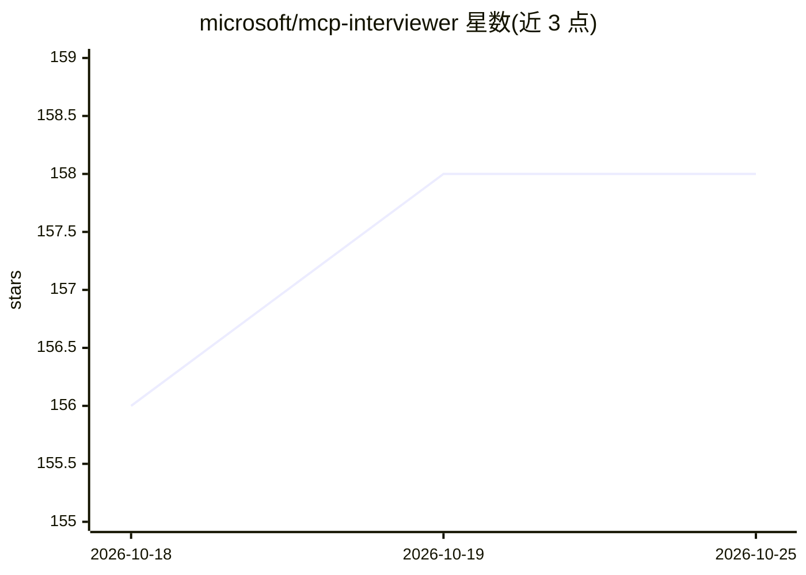

# microsoft/mcp-interviewer

⭐ 158 · Python · MIT · 推送 2026-09-14 · [GitHub](https://github.com/microsoft/mcp-interviewer) · 组织维护

**MCP 服务器检查工具：约束检查、功能测试与评估报告**

Microsoft 出品的 Python CLI 工具，用于在 LLM agent 使用前检查 MCP 服务器：按 OpenAI 等提供方的硬约束与建议（工具数量、名称长度/模式等）做约束检查；可选 --test 让 LLM 生成并执行测试计划，收集工具调用统计；实验性的 LLM 评估生成结构化评价；最终输出 Markdown 与 JSON 报告。模型客户端可自定义，兼容 OpenAI SDK 接口（含本地 Ollama、Azure）。README 声明为研究实验用途，需在隔离容器中运行被测服务器。

## 筛选速览

| 维度 | 判定 | 备注 |
|---|---|---|
| AI 角色 | `ai-ecosystem` | LLM/agent 周边工具 |
| 许可风险 | `permissive` | MIT |
| 部署形态 | `self-host` | docker 或自建部署 |
| 模型依赖 | local-ok | 支持本地模型 |
| 硬件要求 | — | 无带数字的原话,不猜 |
| 安装摩擦 | `low` | 无编译、无系统依赖或容器化 |
| 成熟度 | `idea` | |

## 能力要点

- 约束检查覆盖 OpenAI 工具数量/名称长度/名称模式/Token 长度等规则
- 可选 LLM 功能测试：生成测试计划并执行，收集工具调用统计
- 实验性 LLM 评估与 Markdown/JSON 报告生成
- BYO 模型：任何 OpenAI SDK 兼容客户端均可用

## 适用场景

- 发布 MCP 服务器前检查是否违反提供方约束
- 对 MCP 服务器做功能测试并收集工具调用性能指标
- 生成服务器能力与工具清单的评估报告

## 场景标签

`模型评测` · 领域:评测与运维

## 证据(README 行号)

> L3: A Python CLI tool that helps you catch MCP server issues before your agents do.
> L31: MCP servers are intended to be used by LLM agents, so the interviewer can optionally test them with an LLM agent. W

## 星数曲线

2026-10-18 156 → 2026-10-25 158（+2）

---
*卡片 v1 · prompt 1.4 · 生成 2026-10-22 · 置信度 mid · 依据 README sha `bc9af5ae7d79` · [字段定义](../../DATASET.md)*
