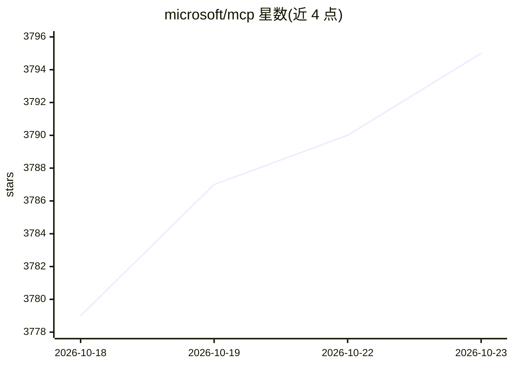

# microsoft/mcp

⭐ 3,795 · C# · MIT · 推送 2026-10-22 · [GitHub](https://github.com/microsoft/mcp) · 组织维护

**微软官方 MCP 服务器集合与目录：让 AI 应用接入 Azure 等服务**

Microsoft 维护的 Model Context Protocol 服务器仓库与目录：本仓库构建 Azure MCP 与 Microsoft Fabric MCP 服务器，并提供核心库、测试框架与工程工具；README 另以目录形式列出微软各团队提供的 20 余个 MCP 服务器（Azure DevOps、AKS、GitHub、Microsoft 365 邮件/日历、Markitdown、Microsoft Learn 等），按云基础设施/开发工具/生产力/数据分析分类，标注 Local 或 Remote 类型及各 IDE 安装入口。供需要在 MCP 客户端（VS Code、Claude Code 等）中接入微软服务的开发者和企业使用。

## 筛选速览

| 维度 | 判定 | 备注 |
|---|---|---|
| AI 角色 | `ai-ecosystem` | LLM/agent 周边工具 |
| 许可风险 | `permissive` | MIT |
| 部署形态 | `None` |  |
| 模型依赖 | — | README 未给出锁定关系 |
| 硬件要求 | — | 无带数字的原话,不猜 |
| 安装摩擦 | `high` | 编译与系统依赖俱全 |
| 成熟度 | `idea` | |

## 能力要点

- 从本仓库构建 Azure MCP 与 Fabric MCP 服务器
- 目录收录 20 余个微软系 MCP 服务器，按类别与 Local/Remote 类型标注
- 每个条目给出 VS Code/Visual Studio/IntelliJ/Claude Code 等安装入口
- 提供核心库、测试框架与工程系统供 MCP 服务器贡献者复用

## 适用场景

- 在 VS Code 等编辑器中让 AI 代理操作 Azure 资源
- 为 AI 助手接入 Microsoft 365 邮件、日历与文档检索能力
- 查找并安装微软生态的各类 MCP 服务器

## 场景标签

 · 领域:AI Agent 工具接入/云计算

## 证据(README 行号)

> L5: **Model Context Protocol (MCP)** is an open protocol that standardizes how applications provide context to large lan
> L15: This repository contains core libraries, test frameworks, engineering systems, pipelines, and tooling for Microsoft
> L26: - **DESCRIPTION**: All Azure MCP tools in a single server. The Azure MCP Server implements the MCP specification to

## 星数曲线

2026-10-18 3,779 → 2026-10-23 3,795（+16）

---
*卡片 v1 · prompt 1.4 · 生成 2026-10-20 · 置信度 high · 依据 README sha `1e38d8d535d2` · [字段定义](../../DATASET.md)*
