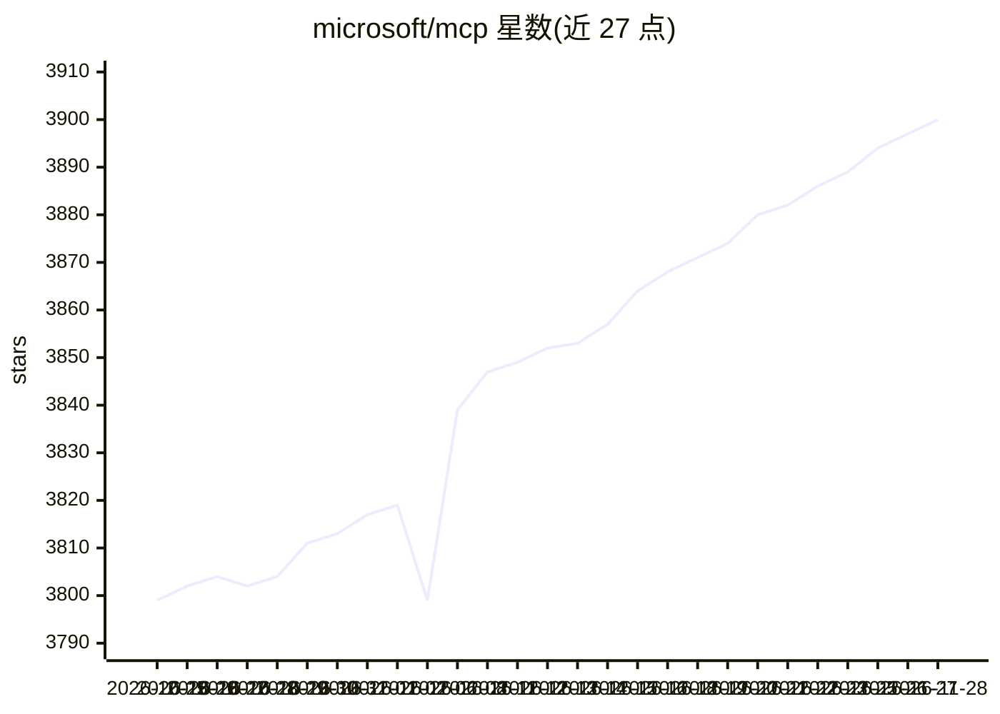

# microsoft/mcp

⭐ 3,900 · C# · MIT · 推送 2026-11-27 · [GitHub](https://github.com/microsoft/mcp) · 组织维护

**微软官方 MCP 服务器目录：让 AI 应用接入数据与工具**

微软 MCP（Model Context Protocol）服务器实现的官方目录：MCP 是将应用上下文标准化提供给 LLM 的开放协议，采用客户端-服务器架构。本仓库包含供微软 MCP Server 贡献者使用的核心库、测试框架与工程管线，并编目 Azure、Microsoft Fabric、Azure DevOps、AKS、Microsoft 365、Clarity、Dataverse 等 MCP 服务器条目，逐条给出描述、类别、类型（Local/REMOTE）与安装入口，覆盖 VS Code、Visual Studio、IntelliJ、Claude Code 等宿主安装方式。

## 筛选速览

| 维度 | 判定 | 备注 |
|---|---|---|
| AI 角色 | `ai-ecosystem` | LLM/agent 周边工具 |
| 许可风险 | `permissive` | MIT |
| 部署形态 | `None` |  |
| 模型依赖 | — | README 未给出锁定关系 |
| 硬件要求 | — | 无带数字的原话,不猜 |
| 安装摩擦 | `high` | 编译与系统依赖俱全 |
| 成熟度 | — | 结构信号不足 |

## 能力要点

- 编目 Azure、Fabric、M365、AKS 等多个微软官方 MCP 服务器
- 每条目提供描述、类别、Local/REMOTE 类型与安装入口
- 包含核心库、测试框架与工程管线，统一微软 MCP Server 工程投入
- 支持 VS Code、Visual Studio、IntelliJ、Eclipse、Claude Code 等安装宿主

## 适用场景

- 为 AI agent 或 IDE 查找接入 Azure / Microsoft 365 服务的 MCP 服务器
- 作为贡献者参与微软 MCP 服务器的统一工程体系
- 查询某微软产品 MCP 服务器的远程端点或安装方式

## 场景标签

`精选清单` · 领域:学习与行业

## 证据(README 行号)

> L5: **Model Context Protocol (MCP)** is an open protocol that standardizes how applications provide context to large lan
> L15: This repository contains core libraries, test frameworks, engineering systems, pipelines, and tooling for Microsoft

## 星数曲线

2026-10-25 3,799 → 2026-11-28 3,900（+101）

---
*卡片 v1 · prompt 1.4 · 生成 2026-11-23 · 置信度 high · 依据 README sha `2b72da6e7ca1` · [字段定义](../../DATASET.md)*
