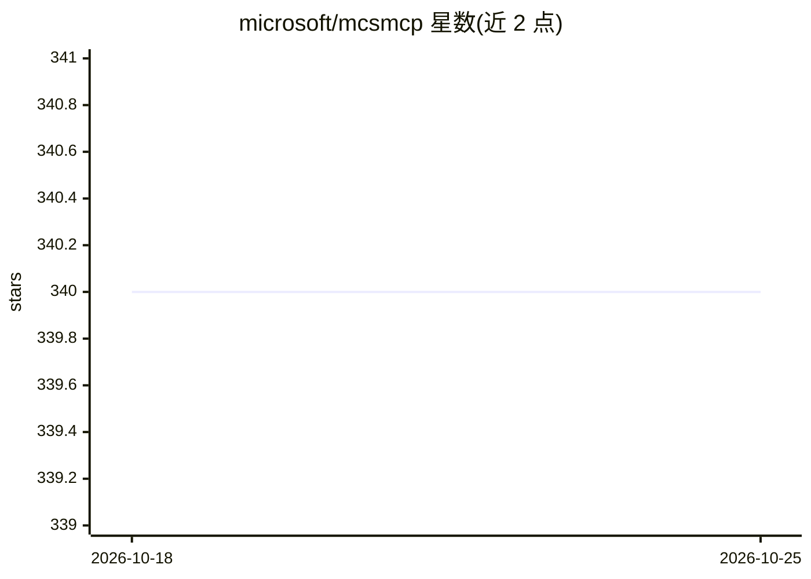

# microsoft/mcsmcp

⭐ 340 · 推送 2026-03-08 · [GitHub](https://github.com/microsoft/mcsmcp) · 组织维护

**创建 MCP Server 并在 Copilot Studio 使用的实验教程（已迁移）**

Microsoft 维护的实验室教程仓库，主题为创建 MCP Server 并在 Microsoft Copilot Studio 中使用。当前 README 仅声明本实验已迁移至其他位置，未在本文档中保留安装步骤、代码或使用说明。读者需前往迁移目标地址获取内容。作为教程/实验类仓库，面向希望学习 MCP 与 Copilot Studio 集成的开发者。

## 筛选速览

| 维度 | 判定 | 备注 |
|---|---|---|
| AI 角色 | `ai-knowledge` | 知识聚合/清单类 |
| 许可风险 | `none` | — |
| 部署形态 | `None` |  |
| 模型依赖 | — | README 未给出锁定关系 |
| 硬件要求 | — | 无带数字的原话,不猜 |
| 安装摩擦 | `low` | 无编译、无系统依赖或容器化 |
| 成熟度 | — | 结构信号不足 |

## 能力要点

- MCP Server 创建与 Copilot Studio 使用教程
- README 声明实验内容已迁移至新地址

## 适用场景

- 学习如何构建 MCP Server 并接入 Copilot Studio

## 场景标签

`教程课程` · 领域:学习与行业

## 证据(README 行号)

> L1: # Microsoft Copilot Studio ❤️ MCP
> L3: This lab has been moved to here.

## 星数曲线

2026-10-18 340 → 2026-10-25 340（+0）

---
*卡片 v1 · prompt 1.4 · 生成 2026-10-21 · 置信度 low · 依据 README sha `2a6d91bd4fa1` · [字段定义](../../DATASET.md)*
