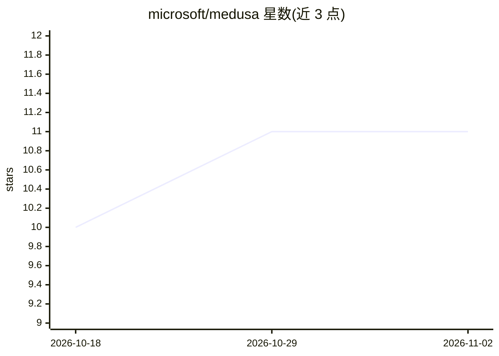

# microsoft/medusa

⭐ 11 · HTML · MIT · 推送 2026-08-04 · [GitHub](https://github.com/microsoft/medusa) · 组织维护

**微软开源的 agentic AI 安全教育小游戏，含 5 个安全主题关卡**

开源教育游戏，通过短篇互动挑战讲解 agentic AI 的安全与风险概念。包含威胁建模、红队测试、防御、日志、事件响应五个小游戏，可单独游玩或作为团队学习材料，面向工作坊、活动与自学场景。仓库同时作为可分支改编的模板：使用者可替换故事与学习内容，制作面向自身受众的教育游戏。README 未给出本产品的安装或运行命令，仅链接游玩入口与配套站点。

## 筛选速览

| 维度 | 判定 | 备注 |
|---|---|---|
| AI 角色 | `ai-knowledge` | 知识聚合/清单类 |
| 许可风险 | `permissive` | MIT |
| 部署形态 | `None` |  |
| 模型依赖 | — | README 未给出锁定关系 |
| 硬件要求 | — | 无带数字的原话,不猜 |
| 安装摩擦 | `low` | 无编译、无系统依赖或容器化 |
| 成熟度 | — | 结构信号不足 |

## 能力要点

- 五个小游戏覆盖威胁建模、红队、防御、日志、事件响应
- 可作为团队学习材料或个人自学使用
- 仓库设计为可分支改编的教育游戏模板
- 由 Microsoft 维护并接受社区贡献

## 适用场景

- 在工作坊或团队活动中学习 agentic AI 安全概念
- 以攻防双视角练习识别与应对 AI 安全风险
- 基于该仓库改编制作自己的教育游戏

## 场景标签

`教程课程` · 领域:学习与行业

## 证据(README 行号)

> L3: **Medusa's Memory Heist** is an open-source educational game that makes agentic AI safety and security easier to exp
> L17: The game includes five mini-games covering core AI security practices:

## 星数曲线

2026-10-18 10 → 2026-11-02 11（+1）

---
*卡片 v1 · prompt 1.4 · 生成 2026-11-02 · 置信度 high · 依据 README sha `cd5c6b12a3dd` · [字段定义](../../DATASET.md)*
