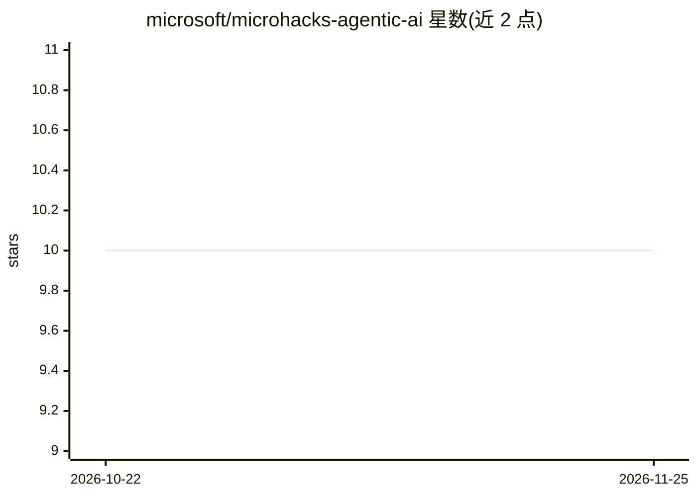

# microsoft/microhacks-agentic-ai

⭐ 10 · Bicep · MIT · 推送 2026-09-14 · [GitHub](https://github.com/microsoft/microhacks-agentic-ai) · 组织维护

**微软官方 Agentic AI 半天动手工作坊教材**

由 Microsoft Office of the CTO Americas 出品的半日动手工作坊（Microhack），源自 Azure AI Agent Service 的入门仓库。以零售销售数据问答场景为背景，让学员使用 Azure AI Agent Service 构建代理应用，探索其工具并学习用指令引导 LLM。材料包括教程仓库、幻灯片与分步挑战，前置条件为 Azure 订阅、Copilot Studio 与 VS Code；示例代码明确声明不适合直接用于生产环境，部分功能处于 preview 阶段。

## 筛选速览

| 维度 | 判定 | 备注 |
|---|---|---|
| AI 角色 | `ai-knowledge` | 知识聚合/清单类 |
| 许可风险 | `permissive` | MIT |
| 部署形态 | `None` |  |
| 模型依赖 | — | README 未给出锁定关系 |
| 硬件要求 | — | 无带数字的原话,不猜 |
| 安装摩擦 | `low` | 无编译、无系统依赖或容器化 |
| 成熟度 | — | 结构信号不足 |

## 能力要点

- 以 Contoso 零售销售数据分析为情境的实操挑战
- 基于 Azure AI Agent Service 构建代理应用
- 配套教程 Deck 与 Challenge 材料
- GitHub Codespaces 免费额度即可完成全部练习

## 适用场景

- 参加半天 Agentic AI 动手培训
- 按工作坊指引在 Azure 上搭建首个代理应用
- 企业内训时以此为教材组织学习

## 场景标签

`数据分析` `教程课程` · 领域:效率与自动化

## 证据(README 行号)

> L4: Hands-on Microhack created by Microsoft Office of the CTO Americas, focused on Agentic AI.
> L26: By the end of this workshop, you will learn to build an agent app using Azure AI Agent Service, explore its tools, 

## 星数曲线

2026-10-22 10 → 2026-11-25 10（+0）

---
*卡片 v1 · prompt 1.4 · 生成 2026-11-19 · 置信度 high · 依据 README sha `7272623c2563` · [字段定义](../../DATASET.md)*
