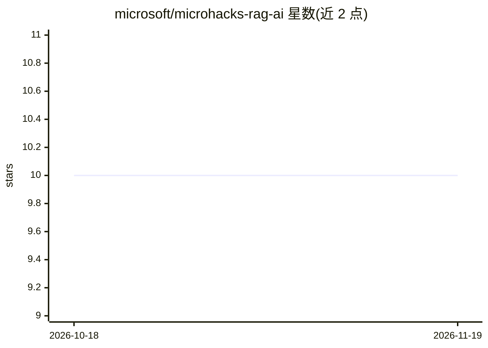

# microsoft/microhacks-rag-ai

⭐ 10 · Python · MIT · 推送 2026-10-27 · [GitHub](https://github.com/microsoft/microhacks-rag-ai) · 组织维护

**微软半天制 RAG 动手工作坊：基于 Azure 构建企业检索问答**

由微软 Office of the CTO Americas 出品的半天制动手工作坊，源自 GPT-RAG 方案加速器。内容围绕在 Azure 上构建 RAG 智能体应用：数据摄取（分块与索引）、Semantic Kernel 编排器、前端应用三组件架构，通过 Azure Developer CLI 四步部署基础架构，并附数据源集成、CI/CD 多环境部署、性能测试、治理与定价评估等进阶指南。面向需要围绕微软技术进行技能培训的企业与开发者，非终端软件产品。

## 筛选速览

| 维度 | 判定 | 备注 |
|---|---|---|
| AI 角色 | `ai-knowledge` | 知识聚合/清单类 |
| 许可风险 | `permissive` | MIT |
| 部署形态 | `None` |  |
| 模型依赖 | — | README 未给出锁定关系 |
| 硬件要求 | — | 无带数字的原话,不猜 |
| 安装摩擦 | `low` | 无编译、无系统依赖或容器化 |
| 成熟度 | — | 结构信号不足 |

## 能力要点

- 半天制动手工作坊，覆盖 RAG 模式与 Azure AI 技术栈
- 基于 GPT-RAG 企业级架构：数据摄取、Semantic Kernel 编排器、前端三组件
- azd 四步完成基础架构部署，文档上传即完成配置
- 附数据源集成（Bing Custom Search/SQL Server/Teradata）、CI/CD 与性能测试指南

## 适用场景

- 参加半天培训学习在 Azure 上构建 RAG 应用
- 从 PoC 迈向生产级企业 RAG 部署时参考架构
- 为销售数据分析搭建对话式问答智能体

## 场景标签

`RAG` `教程课程` · 领域:知识与检索

## 证据(README 行号)

> L5: Hands-on Microhack created by Microsoft Office of the CTO Americas, focused on RAG AI.
> L22: By the end of this workshop, you will learn to build an agent app using Azure AI for RAG, Azure AI Search, explore 

## 星数曲线

2026-10-18 10 → 2026-11-19 10（+0）

---
*卡片 v1 · prompt 1.4 · 生成 2026-11-19 · 置信度 high · 依据 README sha `cda8177b43a1` · [字段定义](../../DATASET.md)*
