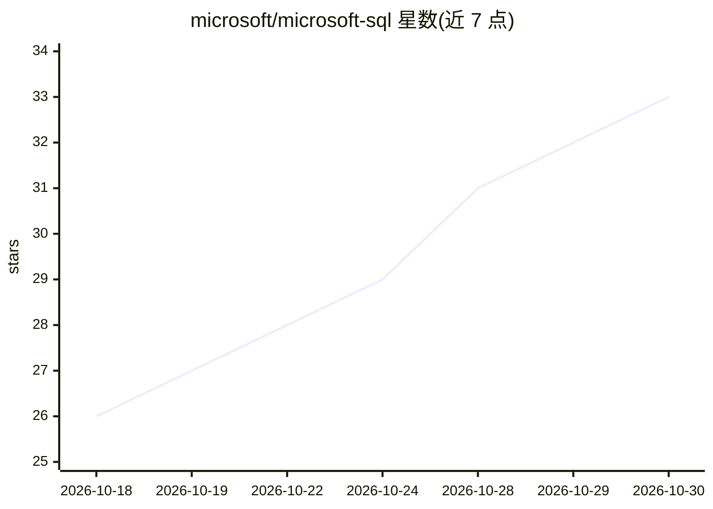

# microsoft/microsoft-sql

⭐ 33 · PowerShell · NOASSERTION · 推送 2026-09-29 · [GitHub](https://github.com/microsoft/microsoft-sql) · 组织维护

**微软官方 SQL 数据库 agent 技能插件市场，覆盖开发运维迁移**

由 Microsoft SQL 产品团队发布的可安装 agent 插件市场（marketplace 名 microsoft-sql），为 GitHub Copilot、Claude Code、Codex、Cursor、Grok Build 等 agent 宿主提供打包的指导与参考，覆盖 Azure SQL 应用开发与运维、本地容器工作流、SQL Server 到 Azure 的迁移评估、以及 Fabric Database Hub 的只读资产分析。共 5 个插件，各自独立安装，跨产品边界的请求会路由到所属能力。安装方式为各宿主的 plugin marketplace 命令或 git clone。

## 筛选速览

| 维度 | 判定 | 备注 |
|---|---|---|
| AI 角色 | `ai-knowledge` | 知识聚合/清单类 |
| 许可风险 | `none` | NOASSERTION |
| 部署形态 | `None` |  |
| 模型依赖 | locked-api |  |
| 硬件要求 | — | 无带数字的原话,不猜 |
| 安装摩擦 | `low` | 无编译、无系统依赖或容器化 |
| 成熟度 | — | 结构信号不足 |

## 能力要点

- 5 个插件：完整 Azure SQL 工作流、本地容器、VS Code、迁移、Fabric Database Hub
- 支持 GitHub Copilot / Claude Code / Codex / Cursor / Grok Build 五类 agent 宿主
- 跨产品请求路由到所属能力或声明未安装，而非生成支持内容
- 容器插件覆盖 Docker、Podman、Compose、Dev Container 与 CI 工作流

## 适用场景

- 让编码 agent 按官方指导连接和开发 Azure SQL 应用
- 在本地用 Azure SQL Database 容器做开发与 CI
- 评估并规划 SQL Server 到 Azure 的迁移路径
- 分析 Fabric Database Hub 资产的性能与安全态势

## 场景标签

`编码 Agent` · 领域:编码与开发

## 证据(README 行号)

> L13: Agent skills are folders of instructions and references that an agent discovers and loads when
> L17: This repository is the installable `microsoft-sql` marketplace. It publishes portable
> L18: Agent Plugins 1.0 packages for GitHub Copilot,

## 星数曲线

2026-10-18 26 → 2026-10-30 33（+7）

---
*卡片 v1 · prompt 1.4 · 生成 2026-10-26 · 置信度 high · 依据 README sha `60b1ea956b78` · [字段定义](../../DATASET.md)*
