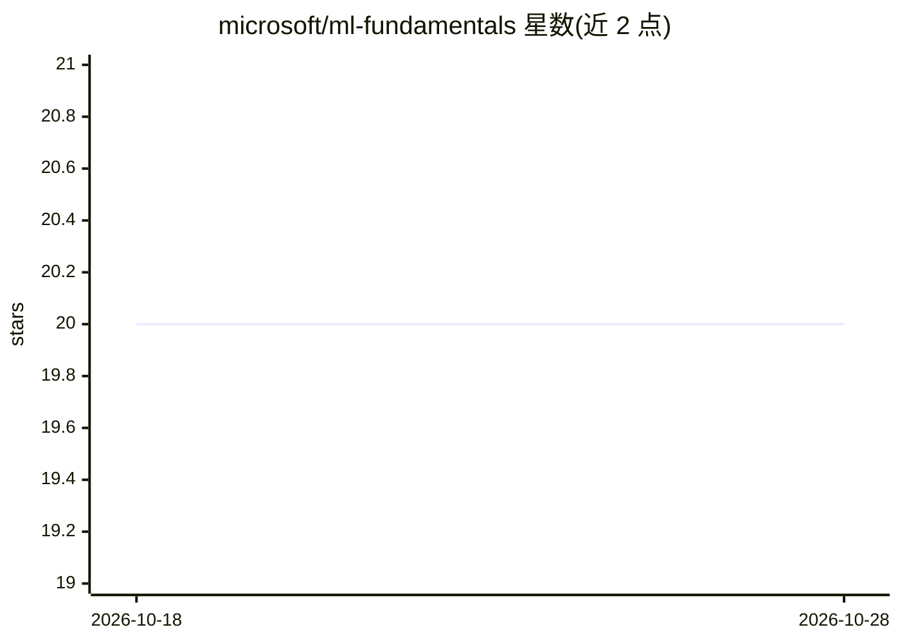

# microsoft/ml-fundamentals

⭐ 20 · Jupyter Notebook · MIT · 推送 2026-06-17 · [GitHub](https://github.com/microsoft/ml-fundamentals) · 组织维护

**微软维护的机器学习基础学习资源库**

微软名下的机器学习基础教学仓库，通过策展材料、代码示例（notebook）和动手练习覆盖监督学习、无监督学习与强化学习三大类别的理论与实践用例。仓库内含样例数据集与运行文档，环境搭建提供三种方式：GitHub Codespaces 云环境、远程 Azure VM（VS Code）、或本地 laptop 自建 Python virtualenv。面向初学者与希望补足 ML 基础的实践者，并附社区交流渠道。

## 筛选速览

| 维度 | 判定 | 备注 |
|---|---|---|
| AI 角色 | `ai-knowledge` | 知识聚合/清单类 |
| 许可风险 | `permissive` | MIT |
| 部署形态 | `None` |  |
| 模型依赖 | — | README 未给出锁定关系 |
| 硬件要求 | — | 无带数字的原话,不猜 |
| 安装摩擦 | `low` | 无编译、无系统依赖或容器化 |
| 成熟度 | — | 结构信号不足 |

## 能力要点

- 覆盖监督/无监督/强化学习三大类别的理论与实践 notebook
- 每种方法配有 notebook 讲解理论基础与实际用例
- 提供 Codespaces、远程 VM、本地 virtualenv 三种环境搭建方式
- 仓库内含样例数据集与运行文档

## 适用场景

- 系统学习机器学习基础概念并动手跑 notebook
- 通过云端或本地环境练习分类、回归、聚类等任务
- 加入社区与学习者交流进度与问题

## 场景标签

`教程课程` · 领域:学习与行业

## 证据(README 行号)

> L3: Welcome to the **Machine Learning Fundamentals** repository! This repo is designed to help you upskill in fundamenta
> L15: For each of these approaches, dedicated notebooks will provide both theoretical foundations and practical use cases

## 星数曲线

2026-10-18 20 → 2026-10-28 20（+0）

---
*卡片 v1 · prompt 1.4 · 生成 2026-10-28 · 置信度 high · 依据 README sha `f72114be542b` · [字段定义](../../DATASET.md)*
