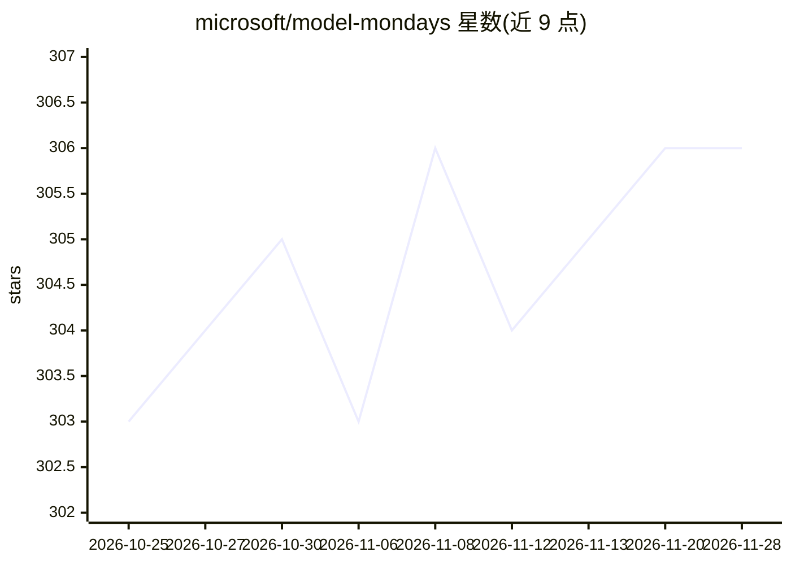

# microsoft/model-mondays

⭐ 306 · Jupyter Notebook · MIT · 推送 2026-11-11 · [GitHub](https://github.com/microsoft/model-mondays) · [官网](https://microsoft.github.io/model-mondays/) · 组织维护

**面向开发者的生成式 AI 模型选型周播直播与 Discord 答疑系列**

微软主办的每周直播系列，包含 5 分钟模型新闻汇总与 15 分钟模型专题（Spotlight），并配套 Discord Office Hours 答疑；另含 Foundry Friday 专家 AMA 与面向初学者的自学课程。内容围绕模型能力、选型、微调与构建 AI Agent 的模式展开，各季节目以 Microsoft Foundry、GitHub Models 及 Cohere、Claude、Mistral、NVIDIA 等模型家族为主题，提供 YouTube 回放。第四季第 12 集因日程冲突取消。

## 筛选速览

| 维度 | 判定 | 备注 |
|---|---|---|
| AI 角色 | `ai-knowledge` | 知识聚合/清单类 |
| 许可风险 | `permissive` | MIT |
| 部署形态 | `None` |  |
| 模型依赖 | — | README 未给出锁定关系 |
| 硬件要求 | — | 无带数字的原话,不猜 |
| 安装摩擦 | `low` | 无编译、无系统依赖或容器化 |
| 成熟度 | — | 结构信号不足 |

## 能力要点

- 每周直播：5 分钟模型汇总 + 15 分钟专题讲解
- 配套 Discord Office Hours 与 Foundry Friday AMA
- 面向初学者的自学课程（Models for Beginners）
- 四季节目回放存放于 YouTube 播放列表

## 适用场景

- 了解不同模型家族的能力与适用场景
- 为构建 AI Agent 学习模型选型与微调方法
- 回看往季 AMA 与专题讲座补齐知识

## 场景标签

`教程课程` · 领域:学习与行业

## 证据(README 行号)

> L13: Model Mondays is a practical livestream series for building model expertise one week at a time. Explore model capab
> L17: - **Models for Beginners:** self-guided curriculum.

## 星数曲线

2026-10-25 303 → 2026-11-28 306（+3）

---
*卡片 v1 · prompt 1.4 · 生成 2026-11-25 · 置信度 high · 依据 README sha `47673616ff08` · [字段定义](../../DATASET.md)*
